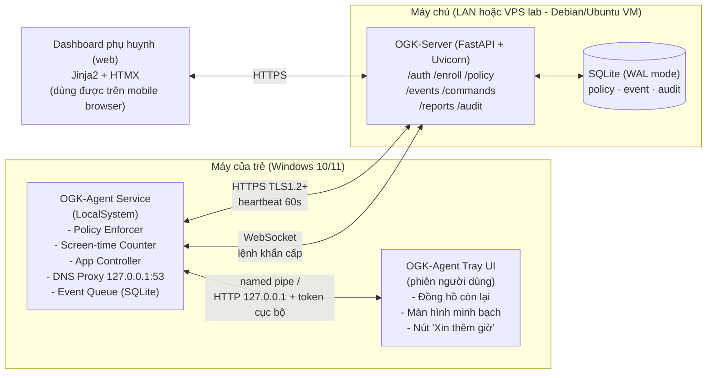
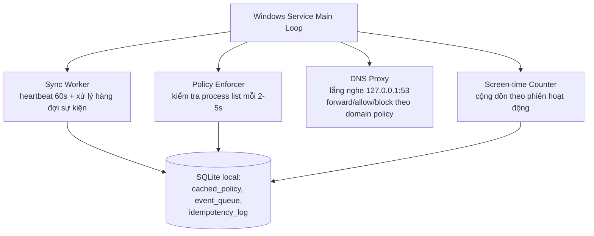
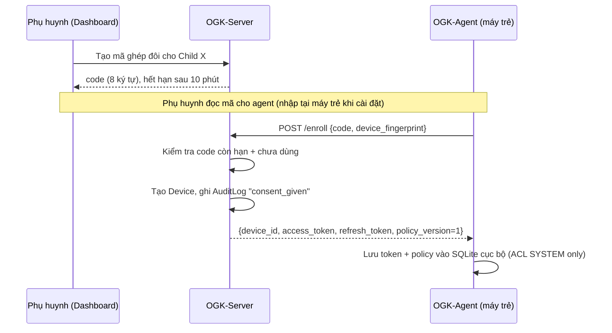

# ChildGuard (OGK) — Thiết kế Kiến trúc Hệ thống

> Phiên bản: 0.2 (cập nhật hợp đồng sự kiện và báo cáo Dashboard)
> Phạm vi: Agent Windows 10/11, OGK-Server (FastAPI), Dashboard phụ huynh, giao thức đồng bộ.

---

## 1. Tổng quan

ChildGuard (tên nội bộ: **OGK** — *Online Guardian Kit*) là hệ thống giám sát và kiểm soát hoạt động máy tính dành cho trẻ nhỏ, theo mô hình client–server phân tán:

- **OGK-Agent**: cài trên máy Windows của trẻ, gồm một Windows Service (chạy dưới quyền `LocalSystem`) thực thi chính sách, và một Tray UI (chạy trong phiên người dùng) hiển thị minh bạch cho trẻ.
- **OGK-Server**: máy chủ điều phối (FastAPI), quản lý thiết bị, chính sách, sự kiện, nhật ký kiểm toán.
- **Dashboard phụ huynh**: giao diện web để phụ huynh cấu hình chính sách, duyệt yêu cầu, xem báo cáo.

Nguyên tắc thiết kế xuyên suốt:

1. **Minh bạch với trẻ** — trẻ luôn biết mình đang bị giám sát (không phải spyware ẩn), có thể xem lý do bị chặn và gửi yêu cầu.
2. **Đồng ý của cha mẹ được ghi nhận** — bước ghép đôi (enrollment) là bằng chứng đồng ý, lưu trong audit log, tham chiếu Nghị định 13/2023/NĐ-CP về bảo vệ dữ liệu cá nhân.
3. **An toàn khi mất mạng** — agent phải tiếp tục hoạt động đúng chức năng cốt lõi (đếm giờ, chặn ứng dụng) ngay cả khi server không phản hồi.
4. **Chống bypass đơn giản** — một đứa trẻ có kiến thức cơ bản (rút mạng, tắt Wi-Fi, đổi giờ hệ thống) không được phép vô hiệu hóa chính sách chỉ bằng thao tác đó.

---

## 2. Kiến trúc tổng thể



**Vì sao chọn Jinja2 + HTMX thay vì React cho Dashboard?** Đồ án cần "cài đặt được trong 15 phút trên máy sạch". Jinja2+HTMX render phía server, không cần bước `npm build`/bundler, không cần Node.js trên VM server — giảm một tầng phụ thuộc, dễ demo, và HTMX vẫn cho trải nghiệm tương tác (partial update) đủ tốt cho các form cấu hình + bảng báo cáo. Đây là quyết định **tối ưu cho việc bàn giao/chấm điểm**, không phải giới hạn kỹ thuật — nếu sau này cần UI phức tạp hơn (biểu đồ tương tác nhiều lớp), có thể thay bằng React mà không đổi API.

---

## 3. Thành phần hệ thống

| Thành phần                             | Trách nhiệm chính                                                                                                   | Công nghệ / Ghi chú kỹ thuật                                                                                                                                                                                       |
| ---------------------------------------- | ---------------------------------------------------------------------------------------------------------------------- | ----------------------------------------------------------------------------------------------------------------------------------------------------------------------------------------------------------------------- |
| **OGK-Agent — Service**           | Áp chính sách, đếm thời gian sử dụng, chặn tiến trình/ứng dụng, lọc DNS, đệm sự kiện khi mất mạng  | Python 3.11+,`pywin32` (`win32serviceutil.ServiceFramework`), `psutil` để liệt kê/kill tiến trình; đăng ký Service Recovery Options (SCM) để tự khởi động lại sau crash                           |
| **OGK-Agent — Tray UI**           | Giao diện cho trẻ: đồng hồ đếm ngược, lý do bị chặn, nút xin thêm giờ                                   | Chạy trong phiên đăng nhập user (không phải SYSTEM); giao tiếp Service qua**named pipe** (ưu tiên) hoặc HTTP `127.0.0.1:<port>` kèm token cục bộ ngẫu nhiên sinh mỗi lần Service khởi động |
| **OGK-Server**                     | Xác thực phụ huynh, quản lý thiết bị/trẻ, phát hành policy, nhận sự kiện, tổng hợp báo cáo, audit log | FastAPI + Uvicorn (ASGI), SQLAlchemy ORM, SQLite chế độ WAL, TLS đầu cuối, rate-limit theo IP/device_id                                                                                                           |
| **Dashboard phụ huynh**           | Cấu hình quota/lịch tuần/danh sách ứng dụng bị chặn, duyệt yêu cầu "xin thêm giờ", xem báo cáo         | Jinja2 + HTMX, responsive (dùng được trên trình duyệt điện thoại)                                                                                                                                             |
| **Kho dữ liệu cục bộ (Agent)** | Bản sao chính sách gần nhất + hàng đợi sự kiện chưa gửi                                                    | SQLite tại`%ProgramData%\ChildGuard\agent.db`, ACL chỉ `SYSTEM` và `Administrators` được ghi (dùng `icacls` khi cài đặt)                                                                              |

### 3.1. Sơ đồ tiến trình nội bộ Agent



---

## 4. Mô hình dữ liệu (OGK-Server)

Bảng chính (SQLAlchemy models), tên bảng số ít viết hoa cho ORM class, tên cột `snake_case`:

| Bảng                  | Cột chính                                                                                                                                                         | Ghi chú                                                                                                                                                                                                                                                              |
| ---------------------- | ------------------------------------------------------------------------------------------------------------------------------------------------------------------- | --------------------------------------------------------------------------------------------------------------------------------------------------------------------------------------------------------------------------------------------------------------------- |
| **Parent**       | `id` (PK), `username`, `fullName`, `gender`, `hashPassword`, `failed_login_attempts`, `locked_until`, `createdAt`                                   | Quản lý thông tin phụ huynh. Có quan hệ**M : N** với `Child` (Nhiều phụ huynh có thể cùng quản lý nhiều trẻ). Quan hệ **1 : N** với `AuditLog`                                                                                      |
| **Child**        | `id` (PK), `username`, `fullName`, `gender`, `createdAt`                                                                                                  | Quản lý thông tin trẻ em. Có quan hệ**M : N** với `Parent`. Có quan hệ **1 : 1** với `Policy`. Quan hệ **1 : N** với `Device`, `EventLog`, `ChildRequest`.                                                                    |
| **Device**       | `id` (PK), `child_id` (FK), `device_name`, `fingerprint_hash`, `refresh_token_hash`, `status`, `createdAt`                                            | Thông tin thiết bị máy tính của trẻ. Liên kết thuộc về 1`Child`. Có quan hệ **1 : N** với `EventLog`, `ChildRequest`, và `Command`.                                                                                                      |
| **Policy**       | `id` (PK), `child_id` (FK), `version`, `hmac_signature`, `quota_json`, `schedule_matrix`                                                                | Thiết lập giới hạn thời gian (JSON) và lịch biểu cho trẻ. Mỗi`Child` chỉ có duy nhất 1 `Policy`. Quan hệ **1 : N** tới `AppRule`, `WebRule`, `EventLog`.                                                                               |
| **AppRule**      | `id` (PK), `policy_id` (FK), `process_name`, `sha256_hash`, `action`                                                                                      | Quy tắc chặn/cho phép ứng dụng. Thuộc về 1`Policy`.                                                                                                                                                                                                          |
| **WebRule**      | `id` (PK), `policy_id` (FK), `domain`, `action`                                                                                                             | Quy tắc chặn/cho phép tên miền website. Thuộc về 1`Policy`.                                                                                                                                                                                                  |
| **EventLog**     | `id` (PK), `idempotency_key` (UNIQUE), `created_at`, `device_id` (FK), `child_id` (FK), `event_type`, `subject`, `duration_sec`, `policy_version` | Ghi nhận sự kiện ứng dụng, tên miền và trạng thái kiểm soát. `event_type` chỉ nhận tập giá trị quy định tại mục 4.1; `subject` không lưu URL đầy đủ. `idempotency_key` chống ghi trùng khi Agent gửi lại lô sau khi mất mạng. |
| **ChildRequest** | `id` (PK), `child_id` (FK), `device_id` (FK), `request_type`, `subject`, `status`, `createdAt`                                                        | Lưu các yêu cầu từ phía agent của trẻ (xin thêm giờ, báo cáo chặn nhầm) để phụ huynh duyệt.                                                                                                                                                         |
| **Command**      | `id` (PK), `device_id` (FK), `command_type`, `payload_json`, `created_at`, `received_at`, `acked_at`                                                  | Hàng đợi chứa lệnh khẩn cấp (LOCK / UNLOCK / GRANT_TIME). Theo dõi thời gian tạo lệnh, agent nhận lệnh và xác nhận thành công.                                                                                                                      |
| **AuditLog**     | `id` (PK), `parent_id` (FK), `action_type`, `ip_address`, `old_value` (JSON), `new_value` (JSON), `timestamp`                                         | Lưu vết toàn bộ thay đổi cấu hình từ phụ huynh, đảm bảo tính minh bạch. Thuộc về 1`Parent`.                                                                                                                                                        |

**Idempotency**: `idempotency_key` = `hash(device_id + local_event_id)`, sinh **tại agent** khi sự kiện xảy ra (không phải khi gửi) — vì vậy vẫn đúng cả khi agent gửi lại nhiều lần do mất kết nối giữa chừng.

### 4.1. Hợp đồng Event Item

Mọi phần của hệ thống (Agent, API, cơ sở dữ liệu, báo cáo và Dashboard) sử dụng duy nhất chín loại sự kiện sau. Trường trên Event Item truyền qua API có tên `type`; khi lưu vào `EventLog`, Server ánh xạ 1:1 sang cột `event_type`:

```text
app_start, app_stop, domain_query, blocked_app, blocked_domain,
quota_warning, locked, unlock_request, override_granted
```

| `type`             | Ý nghĩa                                                                | Quy tắc `subject`                                                                | `duration_sec`                                                       |
| -------------------- | ------------------------------------------------------------------------ | ----------------------------------------------------------------------------------- | ---------------------------------------------------------------------- |
| `app_start`        | Ứng dụng bắt đầu được sử dụng                                  | Tên ứng dụng/tệp thực thi đã chuẩn hóa, ví dụ `chrome.exe`             | `0`                                                                  |
| `app_stop`         | Ứng dụng kết thúc phiên sử dụng                                   | Cùng tên ứng dụng với `app_start` tương ứng                               | Thời lượng phiên ứng dụng; `0` nếu không xác định được |
| `domain_query`     | Thiết bị truy vấn một tên miền                                     | Tên miền đăng ký cấp hai (registrable domain/eTLD+1), ví dụ `youtube.com` | `0`                                                                  |
| `blocked_app`      | Agent đã chặn một ứng dụng                                         | Tên ứng dụng/tệp thực thi đã chuẩn hóa                                     | `0`                                                                  |
| `blocked_domain`   | Agent đã chặn một truy vấn tên miền                               | Tên miền đăng ký cấp hai đã chuẩn hóa                                     | `0`                                                                  |
| `quota_warning`    | Đã phát cảnh báo hạn mức 10, 5, 1 phút hoặc bắt đầu ân hạn | `null`                                                                            | Số giây còn lại tại lúc cảnh báo                               |
| `locked`           | Máy bị khóa do hạn mức, lịch hoặc lệnh phụ huynh                | `null`                                                                            | `0`                                                                  |
| `unlock_request`   | Trẻ gửi yêu cầu mở khóa/thêm thời gian                           | `null`                                                                            | `0`                                                                  |
| `override_granted` | Phụ huynh duyệt ngoại lệ/mở khóa/cấp thêm thời gian             | `null`                                                                            | Số giây được cấp thêm, nếu có                                 |

Quy tắc dữ liệu bắt buộc:

- `type` là enum đóng; API trả `422` cho giá trị ngoài danh sách trên. Không tiếp tục sinh các tên cũ `screen_time`, `app_blocked`, `web_blocked`, `time_warning`. Không duy trì đồng thời hai khóa JSON `type` và `event_type`.
- `subject` chỉ mang danh tính đối tượng. Với sự kiện ứng dụng, đây là tên ứng dụng hoặc tên tệp thực thi, không phải đường dẫn cài đặt. Với sự kiện tên miền, đây là tên miền đăng ký cấp hai, viết thường, bỏ dấu chấm cuối; tuyệt đối không chứa scheme, thông tin đăng nhập, cổng, path, query hay fragment.
- Chuẩn hóa tên miền tại Agent trước khi ghi `event_queue`; Server chuẩn hóa/kiểm tra lại trước khi lưu. Ví dụ `https://www.news.example.com:8443/a?q=1` thành `example.com`. Với public suffix nhiều nhãn, dùng Public Suffix List để `shop.example.co.uk` thành `example.co.uk`, không cắt chuỗi thủ công.
- `subject` bắt buộc với năm loại `app_start`, `app_stop`, `domain_query`, `blocked_app`, `blocked_domain`; bốn sự kiện trạng thái còn lại để `null`. Chuỗi rỗng bị xem là không hợp lệ.
- `created_at` là UTC ISO-8601 và `idempotency_key` vẫn là khóa chống trùng. Việc tổng hợp dựa trên thời điểm sự kiện thực tế, không dựa trên thời điểm Server nhận lô.

Event Item chuẩn trên đường truyền:

```json
{
  "idempotency_key": "ev_6c47...",
  "type": "blocked_domain",
  "subject": "youtube.com",
  "duration_sec": 0,
  "policy_version": 4,
  "created_at": "2026-10-18T08:30:00Z"
}
```

Khi triển khai thay đổi, migration phải chuyển dữ liệu lịch sử `app_blocked -> blocked_app`, `web_blocked -> blocked_domain`, `time_warning -> quota_warning`. Bản ghi `screen_time` cũ chỉ được giữ để đọc báo cáo lịch sử, không phải giá trị hợp lệ cho Event Item mới và không được Agent sinh thêm.

### 4.2. Dữ liệu chặn và phân loại website

Hai nguồn dữ liệu có trách nhiệm tách biệt:

- `server/data/default_blocked_domains.txt`: danh sách tên miền bị chặn trong policy mặc định cho trẻ 6–11 tuổi. Mỗi dòng là một tên miền đăng ký; DNS Proxy áp dụng cho cả tên miền gốc và mọi tên miền con. Khi bị chặn, Agent phát thông báo theo policy và ghi `blocked_domain`.
- `server/data/website_categories.csv`: bảng đúng 200 website phục vụ giải thích log và báo cáo, không tự tạo quyết định chặn. Sáu giá trị category hợp lệ là `education`, `entertainment`, `social_network`, `gaming`, `age_inappropriate`, `unclassified`.

Phân bổ seed hiện tại: 60 giáo dục, 40 giải trí, 30 mạng xã hội, 30 trò chơi, 20 miền mô phỏng trung tính không phù hợp lứa tuổi và 20 miền mô phỏng chờ phân loại. Không lưu hoặc truy cập miền nội dung người lớn thật để kiểm thử.

Module `server/app/domain_categories.py` nạp CSV, chuẩn hóa website công khai về eTLD+1 và trả `unclassified` cho miền không có trong bảng. Việc phân loại chỉ diễn ra trên `subject` đã được chuẩn hóa; URL đầy đủ không được lưu.

---

## 5. Giao thức & vòng đời

### 5.1. Ghép đôi (Enrollment)



- `device_fingerprint` = băm của (Machine GUID từ registry + tên máy + số hiệu ổ đĩa hệ thống) — đủ để phát hiện agent bị copy sang máy khác, **không** thu thập thông tin định danh vượt mức cần thiết (tối giản dữ liệu theo Nghị định 13/2023).
- Việc tạo `Device` + ghi `AuditLog` tại bước này **chính là điểm ghi nhận đồng ý** — cần lưu thêm `consent_text_version` (phiên bản nội dung thông báo đồng ý đã hiển thị) để tra soát sau này nếu chính sách thay đổi.

### 5.2. Nhịp tim (Heartbeat) — mỗi 60 giây

Request: `POST /heartbeat`

```json
{
  "device_id": "...",
  "policy_version": 3,
  "quota_used_seconds": 5400,
  "queued_event_count": 2
}
```

Response:

```json
{
  "policy_version": 4,
  "policy_changed": true,
  "pending_commands": [
    {"command_id": "...", "type": "grant_minutes", "payload": {"minutes": 15}}
  ]
}
```

- Nếu `policy_changed = true` → agent gọi `GET /policy?since_version=3` để lấy đầy đủ bản mới, áp dụng, rồi cập nhật `policy_version` cục bộ.
- Heartbeat **không** phải kênh chính cho lệnh khẩn (xem 5.3) vì độ trễ tối đa của heartbeat có thể lên đến gần 60s — không đạt yêu cầu <5s.

### 5.3. Lệnh khẩn qua WebSocket

- Agent duy trì kết nối `wss://.../ws/{device_id}` (tự reconnect với backoff nếu rớt, tối đa mỗi 5s thử lại).
- Server đẩy `command` ngay khi phụ huynh bấm "Khóa ngay" trên dashboard → yêu cầu độ trễ < 5 giây (đo từ lúc phụ huynh bấm nút đến lúc agent nhận frame).
- Agent phải `ACK` lại qua WebSocket hoặc qua `POST /commands/{id}/ack` — nếu server không nhận ACK trong 10s, lệnh được đẩy lại qua kênh heartbeat tiếp theo như phương án dự phòng (đảm bảo lệnh không bị mất khi WS rớt đúng lúc gửi).
- **Vì sao vẫn cần fallback qua heartbeat dù có WebSocket?** WebSocket có thể rớt do NAT timeout, đổi mạng, sleep máy — không thể coi là kênh đảm bảo 100%. Thiết kế 2 tầng (WS ưu tiên + heartbeat dự phòng) đánh đổi một chút độ phức tạp để đổi lấy độ tin cậy giao lệnh.

### 5.4. Chế độ ngoại tuyến

- Agent luôn giữ **bản sao chính sách gần nhất** trong SQLite cục bộ và tiếp tục:
  - Đếm giờ sử dụng (ghi vào `event_queue`, chưa gửi).
  - Áp app/domain rules như bình thường (không cần server để chặn).
- Khi có mạng trở lại: gửi các event theo lô (`POST /events/batch`), mỗi event kèm `idempotency_key` để server dedupe an toàn dù gửi lại nhiều lần.
- Batch có giới hạn kích thước (vd 200 event/lần) để tránh một lần đồng bộ quá nặng sau khi mất mạng lâu ngày.

### 5.5. Dashboard Phụ huynh

- Đã hoàn thiện Jinja2 = HTMLX
- Chạy server:

```bash
source /opt/childguard/.venv/bin/activate
/opt/childguard/app/server
uvicorn app.main:app --host 0.0.0.0 --port 8443 \
  --ssl-keyfile /opt/childguard/certs/ogk.key \
  --ssl-certfile /opt/childguard/certs/ogk.crt
```

- Nếu bị lỗi về database, xóa file db và server tự tạo lại:

```bash
rm -f /opt/childguard/data/ogk.db*
```

Dashboard:
http://<SERVER_IP>:8443/dashboard
Đăng nhập phụ huynh demo: demo@ogk.local (mật khẩu bất kỳ)
------------------------------------------------------------------

### 5.6. Chính sách hết hạn khi mất kết nối dài ngày — quyết định thiết kế

**Quyết định: FAIL-CLOSED có kiểm soát (không fail-open tuyệt đối), theo 2 giai đoạn.**

| Giai đoạn                                                                  | Điều kiện                                                     | Hành vi                                                                                                                                                                                                                                                                                                                                          |
| ---------------------------------------------------------------------------- | ---------------------------------------------------------------- | ------------------------------------------------------------------------------------------------------------------------------------------------------------------------------------------------------------------------------------------------------------------------------------------------------------------------------------------------- |
| **Giai đoạn 1 — Enforce cứng**                                     | Mất kết nối server từ 0 đến N₁ ngày (đề xuất N₁ = 3) | Tiếp tục áp**nguyên vẹn** policy đã cache: đúng quota, đúng lịch, đúng app/domain rules. Tray UI hiển thị rõ "Không kết nối được máy chủ — vẫn đang dùng chính sách đã lưu từ [ngày]".                                                                                                                  |
| **Giai đoạn 2 — Chế độ an toàn suy giảm (degraded safe-mode)** | Mất kết nối > N₁ ngày, tới N₂ ngày (đề xuất N₂ = 14) | Tiếp tục dùng policy cache gần nhất và danh sách chặn an toàn tích hợp sẵn; không tự chuyển sang cơ chế cho phép theo danh sách. Ghi log rõ ràng `degraded_mode_entered` để audit.                                                                                                                                       |
| **Sau N₂ ngày**                                                      | —                                                               | Vẫn giữ nguyên trạng thái degraded safe-mode,**không** bao giờ tự mở khóa hoàn toàn (fail-open) chỉ vì thời gian trôi qua. Gỡ bỏ hoàn toàn yêu cầu quyền Administrator tại máy (gỡ cài đặt) hoặc mã "unlock khẩn cấp" ký số cấp riêng cho phụ huynh lúc enrollment (lưu offline, không qua mạng). |

**Lý do bảo vệ lựa chọn này (không chọn fail-open):**

1. **Chống bypass tầm thường** — nếu agent fail-open sau N ngày mất mạng, một đứa trẻ chỉ cần rút cáp mạng/chặn agent gọi ra ngoài (vd sửa file hosts, chặn qua firewall) trong đúng N ngày là vô hiệu hóa toàn bộ hệ thống. Đây là lỗ hổng logic nghiêm trọng nhất có thể bị khai thác, nên thiết kế phải loại trừ nó bằng nguyên tắc.
2. **Không "brick" thiết bị vĩnh viễn** — nếu chọn fail-closed tuyệt đối (giữ nguyên policy chặt vô thời hạn), rủi ro là nếu phụ huynh ngừng dịch vụ/gỡ server mà quên gỡ agent đúng cách, máy trẻ bị khóa quá mức không có lối thoát hợp lệ. Giai đoạn 2 (degraded safe-mode) giải quyết việc này: máy vẫn dùng được ở mức tối thiểu (học tập), không bị "chết cứng", nhưng cũng không quay lại mở hoàn toàn.
3. **Cơ chế thoát an toàn thuộc về con người, không phải thời gian** — việc "mở khóa" chỉ nên xảy ra qua hành động có thẩm quyền rõ ràng (gỡ cài đặt bằng quyền Admin, hoặc mã unlock ký số phát tại thời điểm enrollment), không nên là hệ quả tự động của việc chờ đủ N ngày.

> Khi vấn đáp, nếu giám khảo hỏi "vì sao không đơn giản là fail-open sau X ngày cho nhẹ", câu trả lời cốt lõi: **fail-open biến "mất kết nối" thành một vector tấn công có thể chủ động kích hoạt (chỉ cần cắt mạng)**, vi phạm mục tiêu cốt lõi của hệ thống là kiểm soát vẫn hiệu lực ngay cả khi bị chống đối.

---

## 6. Đặc tả API (OGK-Server)

| Method & Path                      | Auth                                                  | Mô tả                                                                                                                         |
| ---------------------------------- | ----------------------------------------------------- | ------------------------------------------------------------------------------------------------------------------------------- |
| `POST /auth/login`               | Không (nhập email/mật khẩu)                       | Phụ huynh đăng nhập, trả JWT session cho dashboard                                                                         |
| `POST /enroll`                   | Enrollment code                                       | Ghép đôi thiết bị mới, trả`device_id` + token pair                                                                     |
| `POST /auth/refresh`             | Refresh token                                         | Cấp access token mới                                                                                                          |
| `GET /policy?since_version=`     | Access token (agent)                                  | Lấy policy đầy đủ nếu có bản mới hơn`since_version`                                                                 |
| `POST /policy`                   | Session (parent, qua dashboard)                       | Tạo phiên bản policy mới cho một child                                                                                     |
| `POST /heartbeat`                | Access token (agent)                                  | Vòng lặp 60s: gửi trạng thái, nhận version + lệnh chờ                                                                   |
| `WS /ws/{device_id}`             | Access token (agent, qua query/header lúc handshake) | Kênh lệnh khẩn thời gian thực                                                                                              |
| `POST /events/batch`             | Access token (agent)                                  | Gửi lô Event Item (`type`, `subject`, ...) theo mục 4.1, kiểm tra dữ liệu và chống trùng bằng `idempotency_key` |
| `GET /reports/{child_id}`        | Session (parent)                                      | Báo cáo sử dụng ngày/tuần, toàn bộ sự kiện gần nhất, Top 10 `blocked_app` và `blocked_domain`                  |
| `POST /reports/cleanup`          | Token/Session                                         | Tác vụ dọn dẹp tự động log, sự kiện, kiểm toán quá 90 ngày                                                         |
| `POST /reports/{child_id}/purge` | Session (parent)                                      | Xóa toàn bộ dữ liệu của con (Server + phát lệnh clear_data xuống Agent)                                                |
| `GET /dashboard/today`           | Công khai / Session                                  | Màn hình "Hôm nay em đã dùng gì" cho trẻ với hình ảnh trực quan                                                     |
| `POST /today/request-time`       | Công khai / Form                                     | Trẻ gửi yêu cầu xin thêm giờ từ màn hình của bé                                                                      |
| `GET /audit`                     | Session (parent, chỉ xem của con mình)             | Xem nhật ký kiểm toán liên quan                                                                                            |

Tất cả endpoint có rate-limit theo `device_id` hoặc `parent_id` (vd `slowapi` middleware) để chống lạm dụng heartbeat/spam.

### 6.1. Quy tắc tổng hợp Nhật ký sử dụng

- `recent_events` lấy trực tiếp từ `EventLog` của trẻ, sắp xếp `created_at DESC`, giới hạn 20 bản ghi sau khi áp dụng phạm vi thời gian của báo cáo. Không lọc riêng sự kiện sử dụng máy và không dùng chuỗi `if/elif` chỉ nhận một vài loại cũ.
- Dashboard ánh xạ đủ chín `event_type` sang nhãn tiếng Việt: Bắt đầu ứng dụng, Dừng ứng dụng, Truy vấn tên miền, Chặn ứng dụng, Chặn tên miền, Cảnh báo hạn mức, Đã khóa máy, Yêu cầu mở khóa và Đã cấp ngoại lệ. Loại không hợp lệ không được lưu; dữ liệu lịch sử chưa di trú hiển thị nhãn thô để phục vụ tra soát.
- Cột “Đối tượng” hiển thị `subject` cho sự kiện app/domain và ký hiệu `—` cho sự kiện trạng thái. Cột “Thời lượng” chỉ hiện giá trị khi `duration_sec > 0`.
- Top 10 ứng dụng bị chặn chỉ đếm các bản ghi có `event_type = 'blocked_app'` và `subject` hợp lệ. Top 10 tên miền bị chặn chỉ đếm `event_type = 'blocked_domain'`. Hai bảng phản ánh **số lần chặn thực tế**, không suy ra từ danh sách chính sách và không đếm `app_start`, `domain_query`.
- Trước khi `GROUP BY`, Server chuẩn hóa app theo `trim + casefold` và domain theo eTLD+1 để các biến thể viết hoa, `www` hoặc subdomain không tách thành nhiều hạng. Kết quả sắp xếp theo `count DESC`, rồi `subject ASC` để ổn định khi bằng số lần.
- Truy vấn báo cáo luôn ràng buộc `child_id` thuộc phụ huynh đang đăng nhập; khoảng thời gian Top 10 trên giao diện là 7 ngày gần nhất và được ghi rõ cạnh tiêu đề.

Ví dụ kết quả rút gọn:

```json
{
  "recent_events": [
    {"type": "blocked_domain", "subject": "youtube.com", "duration_sec": 0},
    {"type": "quota_warning", "subject": null, "duration_sec": 300}
  ],
  "top_blocked_apps": [{"name": "game.exe", "count": 4}],
  "top_blocked_domains": [{"name": "youtube.com", "count": 7}]
}
```

Tên khóa trả về được thống nhất là `top_blocked_domains`; loại bỏ tên cũ `top_blocked_webs` khỏi router, template và PDF để tránh một nguồn dữ liệu có hai tên.

---

## 7. Cấu trúc thư mục dự án

> Cập nhật sau mỗi tính năng lớn. ✅ = đã có code thật (đã giao cho bạn) · ⬜ = mới có trong thiết kế, chưa viết.
> Lần cập nhật gần nhất: hoàn thành toàn bộ Server API, WebSocket lệnh khẩn, Dashboard phụ huynh đầy đủ và Agent Windows (Enforcer, DNS Proxy, Sync, Tray UI).

```
ChildGuard/
├── agent/
│   ├── enroll.py                 ✅ Ghép đôi: tính device fingerprint (Machine GUID + hostname,
│   │                                  đã băm SHA256), gọi POST /enroll qua HTTPS bằng CA nội bộ,
│   │                                  lưu device_id + token vào agent_state/.
│   ├── heartbeat.py              ✅ Vòng lặp: gọi POST /heartbeat định kỳ.
│   ├── storage.py                ✅ SQLite cục bộ (agent.db): lưu cached_policy, event_queue,
│   │                                  trạng thái quota và cơ chế Fail-closed an toàn 2 giai đoạn.
│   ├── enforcer.py               ✅ Policy Enforcer & Screen-time Counter: quét process psutil,
│   │                                  terminate app cấm, đếm giờ dùng máy, khóa màn hình Windows.
│   ├── dns_proxy.py              ✅ DNS Proxy 127.0.0.1:53: lọc domain blacklist, trả 0.0.0.0,
│   │                                  forward upstream 8.8.8.8, ghi log chặn web.
│   ├── sync.py                   ✅ Sync Worker: WebSocket wss://.../ws/{device_id} lệnh khẩn <5s,
│   │                                  Heartbeat 60s, đẩy batch events độc lập mỗi 5s với idempotency key.
│   ├── logging_utils.py          ✅ Timestamp log, flush ngay và chống Quick Edit làm tạm dừng console.
│   ├── ipc.py                    ✅ Local IPC Server (127.0.0.1:48123) kết nối Agent với Tray UI.
│   ├── run_agent.py              ✅ Điểm khởi chạy toàn bộ dịch vụ Agent trên Windows.
│   ├── agent_state/               ✅ (tự sinh) device_token.json, agent.db (.gitignore).
│   ├── certs/                     ✅ ogk-ca.crt copy từ server — agent dùng để xác minh TLS.
│   ├── tray/                     ✅ Tray UI (tray_app.py): đồng hồ đếm ngược, màn hình minh bạch,
│   │                                  hộp thoại xin thêm giờ gửi phụ huynh.
│   ├── requirements.txt          ✅ Đã đầy đủ: psutil, websockets, pystray, pillow, pywin32.
│   └── INSTALL_AGENT.md          ✅ Hướng dẫn chi tiết cài đặt và khởi chạy trên Windows.
│
├── server/
│   ├── app/
│   │   ├── __init__.py            ✅ (rỗng — đánh dấu package)
│   │   ├── main.py                ✅ Khởi tạo FastAPI app, mount đầy đủ 9 router API + dashboard
│   │   │                              + static files, endpoint GET /ping.
│   │   ├── database.py            ✅ Engine SQLAlchemy, bật WAL mode + foreign_keys, get_db().
│   │   ├── domain_categories.py    ✅ Nạp bảng 200 website và phân loại domain cho báo cáo.
│   │   ├── policy_rules.py          ✅ Chuẩn hóa quy tắc ứng dụng về danh sách chặn duy nhất.
│   │   ├── models.py              ✅ 10 bảng đầy đủ theo Design: Parent, Child, Device,
│   │   │                              EnrollmentCode, Token, Policy, Command, EventLog,
│   │   │                              ChildRequest, AuditLog.
│   │   ├── schemas.py             ✅ Pydantic schemas cho Auth, Enroll, Heartbeat, Commands,
│   │   │                              Events batch, ChildRequests, PolicyUpdate.
│   │   ├── security.py            ✅ Sinh mã ghép đôi, sinh/băm token, mật khẩu, JWT session.
│   │   ├── deps.py                ✅ get_current_device() & get_current_parent() / get_optional_parent().
│   │   └── routers/
│   │       ├── __init__.py        ✅ (rỗng)
│   │       ├── enroll.py          ✅ POST /enroll
│   │       ├── heartbeat.py       ✅ POST /heartbeat, GET /policy
│   │       ├── commands.py        ✅ WS /ws/{device_id}, POST /commands, POST /commands/{id}/ack
│   │       ├── events.py          ✅ POST /events/batch (đồng bộ ngoại tuyến + idempotency)
│   │       ├── policy.py          ✅ POST /policy (cập nhật policy tăng version), GET /policy/child/{id}
│   │       ├── requests.py        ✅ POST /requests (agent gửi), GET /requests, POST .../action (duyệt/từ chối)
│   │       ├── reports.py         ✅ GET /reports/{child_id} (thống kê screen time, top app/web bị chặn)
│   │       ├── auth.py            ✅ POST /auth/login, /auth/logout, GET /auth/me
│   │       └── dashboard.py       ✅ Toàn bộ router giao diện web phụ huynh (overview, policy,
│   │                                  requests, reports, audit, action command).
│   ├── data/
│   │   ├── default_blocked_domains.txt ✅ Danh sách chặn của policy mặc định 6–11 tuổi.
│   │   └── website_categories.csv      ✅ 200 website thuộc đúng 6 nhóm báo cáo.
│   ├── scripts/
│   │   ├── create_enrollment_code.py ✅ CLI tạo mã ghép đôi + tài khoản demo.
│   │   └── create_test_command.py ✅ CLI tạo lệnh thử nghiệm cho thiết bị.
│   └── requirements.txt           ✅ fastapi, pydantic, sqlalchemy, uvicorn, httpx, pytest, jinja2, python-multipart.
│
├── dashboard/
│   ├── templates/
│   │   ├── base.html              ✅ Khung layout chuẩn: Sidebar điều hướng + HTMX + Header.
│   │   ├── login.html             ✅ Giao diện đăng nhập phụ huynh.
│   │   ├── overview.html          ✅ Tổng quan: tiến trình quota hôm nay, nút điều khiển khẩn
│   │   │                              cấp (Khóa ngay, Mở khóa, +15p, +30p), duyệt yêu cầu nhanh.
│   │   ├── policy.html            ✅ Quản lý chính sách: Quota ngày, Lịch tuần, App blacklist, Web blacklist.
│   │   ├── requests.html          ✅ Danh sách yêu cầu xin thêm giờ của trẻ + nút Duyệt/Từ chối.
│   │   ├── reports.html           ✅ Báo cáo thống kê trực quan thời gian sử dụng (ngày 24h & tuần 7d),
│   │   │                              nhật ký đủ 9 loại sự kiện, Top 10 `blocked_app`/`blocked_domain`
│   │   │                              kèm số lần, nút Xóa toàn bộ dữ liệu của con tôi.
│   │   ├── child_today.html       ✅ Màn hình 'Hôm nay em đã dùng gì' cho trẻ: ngôn ngữ đơn giản,
│   │   │                              hình ảnh minh họa ấm áp, phân bổ thời gian và nút xin thêm giờ.
│   │   ├── audit.html             ✅ Nhật ký kiểm toán minh bạch theo Nghị định 13/2023.
│   │   └── device_status.html     ✅ Trang dev xem danh sách thiết bị.
│   └── static/css/
│       └── style.css              ✅ Bộ giao diện CSS hiện đại, responsive mobile/desktop.
│
├── tests/
│   ├── conftest.py                ✅ Fixture db_session + client dùng SQLite test riêng biệt.
│   ├── test_enroll.py             ✅ 20 test tính năng ghép đôi.
│   ├── test_heartbeat.py          ✅ 11 test nhịp tim, xác thực token, pending commands.
│   ├── test_commands.py          ✅ 5 test tạo lệnh, WebSocket/delivery, ack command.
│   ├── test_events_batch.py      ✅ Kiểm thử enum 9 loại, quy tắc subject, chuẩn hóa domain,
│   │                                 batch upload và idempotency key deduplication.
│   ├── test_policy.py            ✅ 2 test cập nhật policy tăng version và lấy policy.
│   ├── test_requests.py          ✅ 2 test tạo và phê duyệt/từ chối yêu cầu của trẻ.
│   ├── test_app_enforcer.py      ✅ Kiểm thử danh sách ứng dụng bị chặn & đối chiếu SHA-256.
│   ├── test_hosts_blocker.py     ✅ 6 test DNS proxy & Windows hosts blocker.
│   ├── test_weekly_schedule.py   ✅ 2 test ma trận lịch tuần 7x48.
│   ├── test_screen_time_sync.py  ✅ 5 test đếm thời gian thực & đồng bộ UTC chống tua RTC.
│   ├── test_warnings_and_grace_period.py ✅ 24 test cảnh báo trước 10, 5, 1 phút & ân hạn 60s.
│   └── test_reports_and_retention.py ✅ Kiểm thử nhật ký đủ loại, Top 10 từ sự kiện chặn mới,
│                                      retention 90 ngày tự động và xóa dữ liệu 2 chiều.

│
├── demo/
│   ├── overview_preview.html      ✅ Bản xem trước tĩnh (mock data) của trang Tổng quan đầy đủ.
│   └── style.css                  ✅
│
├── docs/
│   ├── ChildGuard-Design.md       ✅ (file này) — cập nhật liên tục.
│   ├── SETUP_ENVIRONMENT.md       ✅ Hướng dẫn môi trường (VM NAT, TLS, port-forward, khắc phục
│   │                                  sự cố mạng, bao gồm lỗi Python 3.14 + pydantic-core).
│   ├── BaoCao.docx                ⬜
│   ├── BaoCaoKyThuatMang.pdf      ⬜
│   ├── PRIVACY.md                 ⬜
│   ├── THREATMODEL.md             ⬜
│   └── AI_USAGE.md                ⬜
│
├── .gitignore                     ✅ (có agent_state/)
└── README.md                      ⬜ Viết sau cùng, khi agent+server+dashboard chạy được với nhau.
```

---

## 8. Bảo mật (tóm tắt — chi tiết đầy đủ nằm ở `THREATMODEL.md`)

- **Kênh truyền**: bắt buộc TLS 1.2+ cho mọi giao tiếp Agent↔Server và Dashboard↔Server (kể cả trong LAN lab).
- **Token**: access token thời gian sống ngắn (khuyến nghị 15 phút), refresh token dài hạn nhưng revoke được (đánh dấu `revoked` trong bảng `Token`, không dùng blacklist JWT phức tạp).
- **ACL cục bộ**: file SQLite và thư mục cấu hình tại `%ProgramData%\ChildGuard\` chỉ cho `SYSTEM` và `Administrators` ghi (set bằng `icacls` lúc cài đặt) — Tray UI chạy quyền user thường không được ghi trực tiếp.
- **Named pipe Service↔Tray**: xác thực bằng token cục bộ sinh ngẫu nhiên mỗi lần Service khởi động, không hard-code.
- **Idempotency key**: chống đếm trùng thời gian sử dụng khi đồng bộ lại sau mất mạng.
- **Rate limiting**: chống heartbeat giả mạo / DoS vào `/heartbeat`, `/events/batch`.
- **Tối giản dữ liệu**: chỉ lưu fingerprint đã băm, không lưu thông tin định danh vượt mức cần thiết — làm nền cho `PRIVACY.md`.

---

## 9. Môi trường triển khai đề xuất

| Máy                                                           | Vai trò                                  | Ghi chú                                                                                                                                                                       |
| -------------------------------------------------------------- | ----------------------------------------- | ------------------------------------------------------------------------------------------------------------------------------------------------------------------------------ |
| Windows 10 (máy vật lý của bạn)                           | Chạy & test**OGK-Agent** thực tế | Cần quyền Administrator để cài Windows Service                                                                                                                            |
| VMware — Debian nhẹ (tương thích Ubuntu)                  | Chạy**OGK-Server**                 | Debian 12 "bookworm" tương thích tốt với các hướng dẫn Ubuntu (cùng dòng apt/systemd); dùng bản netinst tối giản, chỉ cài thêm Python 3.11+, không cần GUI |
| Windows 10 (trình duyệt) hoặc điện thoại trong cùng LAN | Truy cập**Dashboard**              | Kiểm tra route LAN giữa Windows host và VM (bridged network trong VMware)                                                                                                   |

Ở bước tiếp theo (khi bạn sẵn sàng cho phần thực thi), mình sẽ hướng dẫn theo đúng thứ tự: (1) chuẩn bị VM Debian + cài Python/dependencies cho server, (2) chuẩn bị máy Windows cho agent (Python, pywin32, quyền Service), (3) viết code từng module theo thứ tự server → agent service → tray UI → dashboard, (4) test tích hợp giữa 2 máy qua LAN, (5) đóng gói cài đặt (installer/script) và tài liệu.

---

## 10. Chi tiết Các Hạng mục Đã Xây dựng & Sửa đổi

Phần này ghi lại chi tiết các module chức năng đã xây dựng, tối ưu hóa và sửa đổi trong toàn bộ hệ thống, phân chia theo hai thành phần chính: **OGK-Server** và **OGK-Agent**.

---

### 10.1. Phía Máy chủ OGK-Server (Debian / FastAPI)

#### 10.1.1. Cấu hình Kênh truyền Bảo mật & Sinh Chứng chỉ CA Nội bộ (mTLS & SAN Certificate)

- **Hướng phát triển**:
  - Triển khai FastAPI chạy trên nền Uvicorn với giao thức HTTPS/WSS tại cổng 8443.
  - Áp dụng cơ chế Certificate Pinning với một CA nội bộ (`ogk-ca.crt`), không phụ thuộc vào CA thương mại công cộng.
  - Sinh chứng chỉ máy chủ `ogk.crt` được ký bởi `ogk-ca.key` với trường Subject Alternative Name (SAN) chứa IP tĩnh hoặc domain của máy chủ trong mạng LAN.
- **Các lỗi đã gặp**:
  - **Lỗi xác thực SSL phía Client**: Khi Agent trên Windows gọi `POST /enroll`, gặp lỗi `[SSL: CERTIFICATE_VERIFY_FAILED] certificate verify failed: unable to get local issuer certificate (_ssl.c:1082)`. Nguyên nhân do chứng chỉ `ogk.crt` ban đầu thiếu trường `subjectAltName` chứa địa chỉ IP thực tế của máy chủ (`IP:192.168.204.100`), hoặc phía client thiếu tệp `ogk-ca.crt`.
  - **Lỗi kết nối Timeout**: Client không kết nối được tới cổng 8443 do tường lửa `ufw` trên Debian chưa mở cổng hoặc Uvicorn chỉ bind trên `127.0.0.1`.
- **Cách sửa**:
  - Viết lại file cấu hình mở rộng `ogk.ext` bổ sung đầy đủ SAN: `subjectAltName=IP:192.168.204.100,DNS:ogk-server,DNS:localhost`. Ký lại chứng chỉ máy chủ bằng lệnh OpenSSL x509 chuẩn.
  - Phân phối file công khai `ogk-ca.crt` sang máy client và hướng dẫn kiểm tra mã băm MD5 để xác minh tính toàn vẹn.
  - Mở cổng tường lửa trên máy chủ: `sudo ufw allow 8443/tcp` và cấu hình Uvicorn lắng nghe trên mọi giao diện mạng: `--host 0.0.0.0 --port 8443`.

---

#### 10.1.2. Xác thực Ghép đôi Thiết bị & Quản lý Token (Enrollment & Token Lifecycle)

- **Hướng phát triển**:
  - API `POST /enroll`: Xác thực mã ghép đôi 8 ký tự (TTL 10 phút, bảng `enrollment_codes`).
  - Tiếp nhận `device_fingerprint` (đã băm SHA256 từ `MachineGuid` + hostname phía Agent) và tạo bản ghi thiết bị trong bảng `devices`.
  - Cấp cặp mã thông báo ngẫu nhiên mật mã học: `access_token` (truy cập ngắn hạn) và `refresh_token` (dài hạn). Server chỉ lưu bản băm SHA256 trong bảng `tokens`.
  - Ghi nhận bắt buộc sự đồng ý (Consent Audit Log) vào bảng `audit_logs` cho mỗi lượt ghép đôi thành công.
- **Các lỗi đã gặp**:
  - **Lỗi từ chối kết nối WebSocket HTTP 403 (Policy Violation)**: Sau 15 phút hoạt động, khi Agent kết nối lại WebSocket `/ws/{device_id}`, Server ngắt kết nối với mã lỗi 403. Nguyên nhân do `ACCESS_TOKEN_TTL_MINUTES` mặc định chỉ có 15 phút, khi hết hạn thì hàm xác thực từ chối bắt tay WSS.
  - **Lỗi mất token khi khởi động lại máy chủ**: Khi khởi động lại uvicorn mà đường dẫn database bị trỏ sang file mới, làm mất các token đã cấp trước đó.
- **Cách sửa**:
  - Điều chỉnh cấu hình TTL trong `server/app/security.py` cho môi trường phát triển (hoặc triển khai cơ chế làm mới token tự động).
  - Chuẩn hóa đường dẫn lưu trữ database SQLite tại `/opt/childguard/data/ogk.db`, đảm bảo tính bền vững của dữ liệu tài khoản và token.

---

#### 10.1.3. Nhịp tim Dự phòng, Cập nhật Chính sách & Lệnh Khẩn cấp (Heartbeat, Policy Versioning & Commands)

- **Hướng phát triển**:
  - API `POST /heartbeat`: Tiếp nhận thông số từ Agent mỗi 60 giây, cập nhật `last_seen_at`. So sánh phiên bản chính sách mới nhất của trẻ với `policy_version` do Agent gửi lên; nếu khác nhau trả về `policy_changed: true`. Trả về danh sách lệnh khẩn cấp đang chờ (`pending_commands`).
  - API `GET /policy`: Cho phép Agent tải nội dung chi tiết của phiên bản chính sách mới nhất.
  - Kênh điều khiển WebSocket `WS /ws/{device_id}`: Quản lý qua `ConnectionManager`, cho phép phụ huynh phát lệnh khóa/mở máy tức thì với độ trễ < 5 giây.
- **Các lỗi đã gặp**:
  - Server trả về `policy_changed: false` dù phụ huynh đã cập nhật phiên bản chính sách mới trên Dashboard nếu Agent gửi lên version cũ không khớp child_id.
- **Cách sửa**:
  - Chuẩn hóa hàm truy vấn `_latest_policy(db, child_id)` trong `server/app/routers/heartbeat.py` sắp xếp theo `version.desc()`, đảm bảo luôn lấy đúng phiên bản chính sách mới nhất của trẻ tương ứng với thiết bị gửi yêu cầu.

---

#### 10.1.4. Quản lý Chính sách trên Web Dashboard & Chuẩn hóa Dữ liệu (Parent Policy Management)

- **Hướng phát triển**:
  - Giao diện Web Dashboard (Jinja2 Templates) cho phép phụ huynh trực tiếp cấu hình: hạn mức ngày (`daily_minutes`), khung giờ biểu (`start_time`, `end_time`), danh sách đen ứng dụng (`blocked_apps`) và danh sách đen website (`blocked_domains`).
  - Mỗi lần lưu sẽ tự động sinh phiên bản chính sách mới (`version = version + 1`) và ghi nhật ký kiểm toán `audit_logs`.
- **Các lỗi đã gặp**:
  - **Lỗi dữ liệu tên miền không chuẩn hóa**: Khi phụ huynh nhập URL trang web có kèm giao thức (ví dụ: `https://www.facebook.com`, `http://youtube.com/watch`) hoặc dấu gạch chéo `/`, router lưu nguyên chuỗi thô vào cột `domain_rules_json`. Hậu quả là phía Agent không thể so khớp với tên miền DNS thực tế (vốn chỉ là `facebook.com`), làm tính năng chặn web bị vô hiệu hóa.
- **Cách sửa**:
  - Bổ sung logic tự động chuẩn hóa chuỗi tên miền trong hàm `save_policy_page` tại `server/app/routers/dashboard.py`:
    ```python
    domain_list = []
    for line in blocked_domains.splitlines():
        d = line.strip().lower()
        if not d: continue
        if d.startswith("http://"): d = d[7:]
        elif d.startswith("https://"): d = d[8:]
        d = d.split("/")[0].split(":")[0].strip()
        if d and d not in domain_list:
            domain_list.append(d)
    ```

    Giúp tự động làm sạch URL thành tên miền gốc chuẩn trước khi lưu vào cơ sở dữ liệu.

---

### 10.2. Phía Máy Trẻ Em OGK-Agent (Windows 10/11)

#### 10.2.1. Ghép đôi Thiết bị An toàn (Agent Enrollment Script)

- **Hướng phát triển**:
  - Script `agent/enroll.py` thực hiện đọc `MachineGuid` từ registry `HKLM\SOFTWARE\Microsoft\Cryptography`, băm SHA256 thành `device_fingerprint` duy nhất.
  - Khởi tạo ngữ cảnh SSL an toàn với file CA nội bộ `certs/ogk-ca.crt`.
  - Gửi yêu cầu ghép đôi tới máy chủ và lưu kết quả (`device_id`, `access_token`, `refresh_token`, cấu hình máy chủ) vào tệp `agent_state/device_token.json`.
- **Các lỗi đã gặp**:
  - Lỗi không tìm thấy file CA hoặc file chứng chỉ bị sai lệch mã băm so với Server dẫn đến `[SSL: CERTIFICATE_VERIFY_FAILED]`.
  - Lỗi đường dẫn tương đối khi chạy script ở các thư mục khác nhau.
- **Cách sửa**:
  - Thêm cơ chế chuẩn hóa đường dẫn tệp chứng chỉ, hỗ trợ kiểm tra sự tồn tại của file trước khi khởi tạo ngữ cảnh SSL và hướng dẫn người dùng sử dụng đường dẫn tuyệt đối hoặc `Resolve-Path`.

---

#### 10.2.2. Lưu trữ Cục bộ SQLite & Đồng bộ Lô Sự kiện (Agent Storage & Batch Events)

- **Hướng phát triển**:
  - Module `agent/storage.py` quản lý database SQLite cục bộ `agent_state/agent.db`.
  - Bảng `event_queue`: Hàng đợi lưu trữ đủ chín loại sự kiện tại mục 4.1. Mỗi sự kiện có khóa `idempotency_key = ev_<uuid>` để đảm bảo không bị đếm trùng khi gửi lại.
  - `add_event()` kiểm tra enum và quy tắc `subject` trước khi ghi. Bản ghi cục bộ và payload đồng bộ dùng khóa `type` thống nhất; Server mới ánh xạ sang `EventLog.event_type`. Tên ứng dụng chỉ giữ tên hiển thị/tệp thực thi; tên miền được chuyển về eTLD+1 và không lưu URL đầy đủ.
  - Bảng `agent_state`: Lưu trữ số giây dùng máy hôm nay (`quota_used_seconds`), cờ khóa (`is_locked`), thời điểm liên lạc server cuối cùng (`last_server_contact_ts`).
  - Hàm `mark_events_sent`: Đánh dấu `sent = 1` và dọn dẹp các sự kiện đã được Server xác nhận.
- **Các lỗi đã gặp**:
  - **Lỗi SQLite bindings mismatch**: Ghi nhận lỗi `[Sync] Chưa gửi được batch events: Incorrect number of bindings supplied. The current statement uses 11, and there are 0 supplied`. Nguyên nhân do trong câu lệnh `DELETE FROM event_queue WHERE sent = 1 AND id IN (...)` đã quên truyền danh sách đối số `event_ids`.
- **Cách sửa**:
  - Sửa lại hàm `mark_events_sent` trong `agent/storage.py`: truyền bổ sung danh sách `event_ids` vào đối số thứ hai của hàm `conn.execute()`.

---

#### 10.2.3. Bộ lọc Website & Chặn Tên miền (DNS Proxy & Windows Hosts Blocker)

- **Hướng phát triển**:
  - Ngăn chặn trẻ truy cập các website nằm trong danh sách đen của cha mẹ trên mọi trình duyệt.
  - Ban đầu thiết kế bằng DNS Proxy UDP lắng nghe tại `127.0.0.1:53` phân tích gói tin DNS truy vấn theo chuẩn RFC 1035.
- **Các lỗi đã gặp**:
  - **Lệch cấu trúc bản ghi DNS (Record Type Mismatch)**: Trình duyệt Edge/Chrome gửi đồng thời câu hỏi IPv4 (Type 1 - A), IPv6 (Type 28 - AAAA) và HTTPS SVCB (Type 65). Code cũ trả về gói phản hồi cứng là Type A (`0.0.0.0`) cho mọi loại câu hỏi, khiến Windows đánh giá gói tin phản hồi bị lỗi định dạng (corrupt).
  - **Multi-Homed DNS Fallback của Windows**: Khi câu trả lời từ `127.0.0.1:53` bị coi là lỗi, Windows DNS Client lập tức fallback gửi truy vấn sang DNS phụ của card mạng (gateway VirtualBox hoặc router), nhận về IP thật và mở web bình thường.
  - **Trình duyệt bật DoH (DNS-over-HTTPS)**: Edge/Chrome tự ý gửi truy vấn HTTPS mã hóa ra ngoài, bỏ qua DNS cục bộ của máy tính.
  - **Lỗi không ghi được vào file hosts do thiếu quyền Administrator**: File `C:\Windows\System32\drivers\etc\hosts` được bảo vệ nghiêm ngặt bởi Windows ACL (chỉ Administrators mới có quyền ghi) và thường bị đặt cờ `ReadOnly`. Khi Agent chạy dưới quyền user thông thường hoặc chưa nâng quyền UAC, hàm ghi file gặp `PermissionError: [Errno 13] Permission denied`.
- **Cách sửa & Cải tiến Kiến trúc 2 lớp**:
  1. **Lớp 1 - Windows Hosts Blocker (Chặn cấp hệ điều hành không thể bypass)**: Xây dựng class `HostsBlocker` trong `agent/dns_proxy.py`. Tự động đồng bộ danh sách cấm trực tiếp vào tệp hệ thống `C:\Windows\System32\drivers\etc\hosts` cho cả IPv4 (`0.0.0.0`) và IPv6 (`::`), mở rộng cho cả `www.` và tên miền gốc. File hosts có độ ưu tiên cao nhất trong hệ điều hành Windows, chặn đứng mọi trình duyệt mà không cần can thiệp card mạng thủ công. Khi Agent dừng, tự động khôi phục file hosts về nguyên trạng.
     - **Xử lý quyền Administrator & Phân quyền ACL tự động**:
       - *Tháo cờ Read-Only*: Tự động gỡ thuộc tính chỉ đọc của file hosts trước khi ghi (`stat.S_IWRITE` và `SetFileAttributesW`).
       - *Tự động cấp quyền vĩnh viễn (One-time ACL Grant)*: Khi có quyền Admin, tự động cấp quyền `Modify` cho nhóm `Users` (`icacls "%SystemRoot%\System32\drivers\etc\hosts" /grant "*S-1-5-32-545:(M)" /c`). Nhờ đó, tất cả các lần cập nhật chính sách sau (kể cả khi chạy quyền người dùng thông thường hoặc dọn dẹp khi dừng) đều có thể ghi trực tiếp tức thì mà không cần hỏi lại UAC.
       - *Fallback Nâng quyền UAC qua PowerShell*: Nếu tiến trình đang chạy mà không có quyền ghi, `HostsBlocker` tự động xuất file tạm và gọi PowerShell chạy ngầm qua `Start-Process powershell -Verb RunAs -EncodedCommand` để ghi đè và cấu hình ACL, đảm bảo không bao giờ bị nghẽn chặn web.
       - *Tự động kiểm tra quyền Admin khi khởi động Agent*: `run_agent.py` tích hợp `ensure_admin()` tự động nhắc nâng quyền qua UAC (có tùy chọn `--no-elevate` nếu muốn chạy hạn chế).
  2. **Lớp 2 - DNS Proxy chuẩn RFC 1035**: Viết lại hàm `build_blocked_response`:
     - Nếu truy vấn Type 1 (A) $\rightarrow$ Trả về IPv4 `0.0.0.0`.
     - Nếu truy vấn Type 28 (AAAA) $\rightarrow$ Trả về IPv6 `::`.
     - Nếu truy vấn Type 65 (HTTPS) hoặc loại khác $\rightarrow$ Trả về mã lỗi `NXDOMAIN` (RCODE = 3).
  3. **Hàm `normalize_domain`**: Tự động bóc tách và làm sạch mọi tiền tố `http://`, `https://`, số cổng và đường dẫn. Tự động gọi `ipconfig /flushdns` sau khi cập nhật.
     - Sau khi phân tích DNS, Agent ghi `domain_query` với `subject` là eTLD+1. Nếu quyết định chặn, Agent ghi thêm `blocked_domain` cho cùng eTLD+1; không đưa QNAME đầy đủ hoặc URL vào `subject`.
  4. **Policy mặc định từ tệp**: Khi ghép đôi thiết bị cho trẻ chưa có policy, Server đọc `server/data/default_blocked_domains.txt`, tạo `domain_rules.mode="blacklist"`, bật SafeSearch và gửi danh sách xuống Agent. Phụ huynh vẫn có thể chỉnh danh sách riêng cho từng trẻ trên Dashboard.

---

#### 10.2.4. Đếm Thời gian Sử dụng & Khóa Màn hình (Policy Enforcer & Screen-time Counter)

- **Hướng phát triển**:
  - Module `agent/enforcer.py` chạy vòng lặp mỗi 2 giây:
    - Quét danh sách tiến trình (`psutil`), ghi `app_start`/`app_stop` theo vòng đời và tự động ngắt ứng dụng bị cấm với event `blocked_app`.
    - Đếm dồn thời gian sử dụng màn hình theo thời gian thực.
    - So sánh với hạn mức ngày (`daily_minutes`) và khung giờ cho phép (`schedule`).
    - Thực thi khóa màn hình bằng Win32 API `ctypes.windll.user32.LockWorkStation()`.
- **Các lỗi đã gặp**:
  - **Thời gian sử dụng bị đóng băng (kẹt vĩnh viễn ở 0.4 phút)**: Biến `is_locked` bị lưu thành `True` trong database SQLite sau một lần thử nghiệm khóa hoặc quá giờ. Trong code cũ có điều kiện `if not is_locked and elapsed > 0: add_screen_time()`. Vì `is_locked == True`, bộ đếm không bao giờ cộng thêm giây nào vào thời gian sử dụng nữa. Đồng thời code không có cơ chế tự mở khóa khi trẻ đăng nhập lại hoặc khi phụ huynh tăng giờ.
  - **Đếm giờ sai khi màn hình đang khóa**: Bộ đếm vẫn trừ giờ khi máy tính đang ở màn hình khóa Lock Screen.
- **Cách sửa**:
  1. **Tự động đánh giá và giải phóng trạng thái khóa**: Mỗi chu kỳ 2 giây, Enforcer tính toán lại điều kiện: nếu chưa vượt hạn mức ngày, đang trong khung giờ cho phép và không bị phụ huynh phát lệnh khóa tay $\rightarrow$ Enforcer tự động xóa cờ khóa `self.storage.set_lock_status(False)` để thời gian tiếp tục được đếm dồn.
  2. **Tích hợp Windows API kiểm tra phiên người dùng**: Bổ sung hàm `is_workstation_locked()` sử dụng API `user32.OpenInputDesktop(0, False, 0x0100)`. Khi máy tính ở màn hình khóa, bộ đếm tạm dừng để không trừ giờ oan của trẻ; khi trẻ đăng nhập vào Desktop, bộ đếm hoạt động trở lại bình thường.
  3. **Tự động mở khóa khi lưu Policy mới**: Trong `storage.py`, khi hàm `save_policy` nhận hạn mức mới lớn hơn thời gian đã sử dụng, hệ thống tự động cập nhật `is_locked = 0`.
  4. **Lịch tuần Cho phép / Khóa với độ phân giải 30 phút (Ma trận $7 \times 48$) & Thực thi khóa trong 5 giây**:
     - Cấu trúc ma trận: 7 ngày (Thứ Hai = 0 .. Chủ Nhật = 6) $\times$ 48 ô thời gian (mỗi ô tương ứng chính xác 30 phút: `00:00-00:30`, `00:30-01:00`, ..., `23:30-24:00`). Giá trị `1` là cho phép, `0` là khóa.
     - Enforcer tính toán ô thời gian hiện tại theo công thức: `day = now.weekday()`, `slot = now.hour * 2 + (now.minute // 30)`.
     - *Khóa trong vòng 5 giây*: Vòng lặp Enforcer chạy chu kỳ 2s $\rightarrow$ khi bước vào khung giờ cấm, lệnh `LockWorkStation()` được thực thi ngay trong vòng 2 giây ($< 5$ giây).
     - *Chống mở khóa ngoài giờ*: Nếu trẻ biết mật khẩu tài khoản và cố tình đăng nhập lại khi ngoài khung giờ, Enforcer kiểm tra trạng thái màn hình (`not is_workstation_locked()`) và tự động khóa lại máy tính ngay lập tức trong tối đa 5 giây.
     - *Giao diện Dashboard*: Cung cấp bảng điều khiển ma trận trực quan cho phép phụ huynh nhấp/kéo chuột, bật tắt nhanh theo ngày/giờ và chọn các mẫu có sẵn (24/7, Khóa tất cả, Giờ học chuẩn, Học tập & Cuối tuần).

---

5. **Kiểm soát Ứng dụng theo Danh sách Chặn & Đối chiếu SHA-256 (Anti-cheat & Identity Resolution)**:
   - *Một chế độ duy nhất*: Danh sách đen (`mode: "blacklist"`) cho phép mọi ứng dụng, chỉ chặn các ứng dụng do phụ huynh khai báo.
   - *Cú pháp quy tắc linh hoạt*: Hỗ trợ `ten_tien_trinh.exe` (theo tên), `ten_tien_trinh.exe:ma_sha256` (đối chiếu cả tên và mã băm SHA-256), hoặc `ma_sha256` (chỉ định mã hash).
   - *Bộ đệm hiệu năng cao*: `get_file_sha256` lưu đệm theo bộ ba `(path, mtime, size)` giúp tránh đọc đĩa I/O lặp lại trong vòng lặp 2 giây.
   - *Nhận diện đúng bản chất khi đổi tên tệp (Anti-cheat)*:
     - Nếu trẻ đổi tên `notepad.exe` thành `game.exe`, Agent băm mã SHA-256 của tệp thực thi, đối chiếu với mã chuẩn của `notepad.exe` và nhận diện đúng ứng dụng là Notepad $\rightarrow$ **KHÔNG bị chặn oan** dù tên tiến trình là `game.exe`.
     - Ngược lại, nếu trẻ đổi tên `game.exe` thành `notepad.exe`, mã hash không trùng khớp với Notepad (hoặc trùng với hash game cấm) $\rightarrow$ Agent nhận diện ứng dụng giả mạo và **tiến hành đóng ngay lập tức**.
   - *Bảo vệ tiến trình hệ thống*: Luôn cho phép các tiến trình thiết yếu của Windows (`explorer.exe`, `svchost.exe`, `csrss.exe`, `python.exe`,...) không bao giờ bị tắt nhầm.
   - *Giao diện Dashboard*: Chỉ hiển thị vùng nhập danh sách ứng dụng bị chặn, không có lựa chọn chế độ.

---

#### 10.2.5. Giao diện Khay Hệ thống & Minh bạch cho Trẻ (System Tray UI & Transparency Window)

- **Hướng phát triển**:
  - Module `agent/tray/tray_app.py` chạy trong phiên người dùng:
    - Hiển thị biểu tượng khiên bảo vệ `🛡️` ở khay hệ thống qua thư viện `pystray`.
    - Menu xem thời gian còn lại.
    - Cửa sổ minh bạch hiển thị chi tiết chính sách cha mẹ đã đặt (hạn mức, giờ giấc, app cấm, web cấm).
    - Cửa sổ “Góc của bé” hiển thị trực tiếp tên các ứng dụng đang bị hạn chế, lấy từ policy hiệu lực qua `GET /status`.
    - Hộp thoại xin thêm giờ (+15, +30, +60 phút) gửi qua IPC lên Server để phụ huynh duyệt.
- **Các lỗi đã gặp**:
  - **Menu và Tooltip hiển thị tĩnh không đếm ngược**: Do `pystray` trên Windows không tự động vẽ lại nội dung MenuItem nếu không có lệnh cập nhật menu định kỳ.
  - **Cửa sổ minh bạch không tự nhảy số**: Dữ liệu chỉ nạp 1 lần lúc mở cửa sổ.
  - **Trùng lặp nút bấm**: Trong mã nguồn cũ của hộp thoại xin thêm giờ bị khai báo 2 lần widget `tk.Button`.
- **Cách sửa**:
  - Bổ sung luồng daemon chạy ngầm mỗi 2 giây trong `tray_app.py`: tự động làm mới `self.icon.title` (hiển thị `ChildGuard — Còn XXp / YYp`) và gọi `self.icon.update_menu()`.
  - Cửa sổ minh bạch Tkinter sử dụng `StringVar` và hàm gọi lặp `root.after(2000, _update_info)` để đếm ngược thời gian thực trực tiếp trước mắt trẻ.
  - Xóa bỏ nút bấm bị khai báo trùng lặp.

---

#### 10.2.6. Đồng bộ Lệnh Khẩn cấp Thời gian thực & Vòng lặp Nhịp tim (SyncWorker & WebSocket Client)

- **Hướng phát triển**:
  - Module `agent/sync.py`:
    - Duy trì kết nối WebSocket `wss://<server>:8443/ws/<device_id>` nhận lệnh tức thì (< 5s).
    - Vòng lặp Heartbeat 60s gửi trạng thái và nhận lệnh khẩn dự phòng.
    - Khi nhận lệnh `lock`/`unlock`/`grant_minutes`, gọi Enforcer thực thi và phản hồi ACK ngay lập tức.
- **Các lỗi đã gặp**:
  - Khi chính sách thay đổi trên Server, Agent nhận được `policy_changed=True` và gọi `fetch_and_apply_policy()`, nhưng danh sách cấm mới không được chuyển tiếp sang DNS Proxy và Hosts Blocker, khiến việc chặn trang web mới chỉ có hiệu lực sau khi tắt và bật lại Agent.
- **Cách sửa**:
  - Truyền tham chiếu `dns_proxy` vào khởi tạo của `SyncWorker`. Khi `fetch_and_apply_policy()` tải xong chính sách mới từ server, tự động kích hoạt `self.dns_proxy.sync_policy_rules(policy_data)` để cập nhật file hosts và bộ lọc DNS ngay lập tức mà không cần khởi động lại tiến trình.
  - Tách việc gửi event khỏi heartbeat: một luồng riêng gọi `POST /events/batch` mỗi 5 giây. Lỗi heartbeat, tải policy hoặc WebSocket vì vậy không còn làm hàng đợi nhật ký bị kẹt.
  - Access Token chỉ được làm mới khi thực sự gần hết hạn hoặc Server trả về `401/403`; không làm mới vô điều kiện khi Agent vừa chạy hay WebSocket vừa ngắt.

---

#### 10.2.7. Đếm Thời gian Sử dụng Thực & Đồng bộ Thời gian UTC Client-Server (Sai số ≤ ±30s/giờ, Chống trễ GMT, Phát hiện Không thao tác > 5 phút)

- **Hướng phát triển & Mục tiêu**:
  - Đếm thời gian sử dụng màn hình thực tế (Screen-time Counter):
    - Không tính thời gian khi máy tính đang ở màn hình khóa (Lock Screen).
    - Không tính thời gian khi người dùng không có thao tác bàn phím/chuột quá 5 phút (Idle timeout $\ge$ 300 giây).
    - Tự động tiếp tục đếm giờ ngay khi người dùng thao tác trở lại.
  - Đảm bảo độ chính xác cao: Sai số tích lũy $\le \pm 30$ giây trên mỗi giờ so với đồng hồ bấm tay chuẩn.
  - Đồng bộ thời gian Client-Server thống nhất theo chuẩn UTC, khắc phục dứt điểm lỗi timer client không chạy và lỗi trễ múi giờ GMT do dùng RTC cục bộ.
- **Các lỗi đã gặp & Nguyên nhân gốc rễ**:
  1. **Timer bên Client bị kẹt / không chạy**:
     - *Nhận diện nhầm màn hình khóa*: Hàm `is_workstation_locked()` cũ chỉ gọi `OpenInputDesktop(0, False, 0x0100)`. Khi Agent chạy trong môi trường Service hoặc phiên người dùng không có quyền trực tiếp, hàm trả về 0 (`NULL`). Code cũ coi 0 là màn hình khóa `is_workstation_locked = True`, làm ngưng hoàn toàn việc cộng thời gian sử dụng.
     - *Khóa giả do lệch múi giờ Lịch biểu*: Hàm `check_schedule()` cũ lấy giờ RTC địa phương (`datetime.now()`) nhưng so sánh với ma trận hoặc mốc ngày UTC, dẫn tới ban ngày bị nhận diện nhầm thành ban đêm (ngoài khung giờ cho phép), liên tục rơi vào nhánh `should_lock = True` khiến timer bị đóng băng.
  2. **Lỗi trễ GMT (lệch 7 tiếng)**:
     - Client dùng ngày theo RTC cục bộ (`date.today().isoformat()`), trong khi Server dùng ngày theo UTC (`datetime.utcnow().date()`). Sự chênh lệch 7 tiếng (GMT+7) khiến các sự kiện sử dụng máy vào buổi sáng bị server lọc bỏ do có timestamp thuộc ngày hôm trước, đồng thời việc reset hạn mức ngày không đồng bộ giữa 2 bên.
  3. **Sai số đếm giờ lớn (> 90 giây/giờ)**:
     - Đoạn code cũ sử dụng phép ép kiểu số nguyên `int(now - last_tick)` với chu kỳ 2s. Mỗi chu kỳ làm mất $0.05 - 0.10$ giây phần dư số thực. Sau 1800 chu kỳ (1 giờ), sai số tích lũy lên tới $90 - 180$ giây, vi phạm nghiêm trọng hạn mức $\le \pm 30$s.
- **Giải pháp kỹ thuật chi tiết đã triển khai**:
  1. **Triệt tiêu sai số làm tròn bằng Monotonic Clock & Subsecond Buffer**:
     - Sử dụng `time.monotonic()` thay cho `time.time()` để không bị ảnh hưởng bởi NTP step adjustments hay việc thay đổi đồng hồ hệ thống.
     - Sử dụng bộ đệm số thực `_subsecond_buffer += elapsed_float`. Ở mỗi tick, chỉ lấy phần nguyên giây `whole_sec = int(_subsecond_buffer)` để ghi vào cơ sở dữ liệu và giữ lại phần dư số thực ($0 \le r < 1.0$ giây) cho chu kỳ tiếp theo:
       $$
       \text{whole\_sec} = \lfloor \text{\_subsecond\_buffer} \rfloor, \quad \text{\_subsecond\_buffer} \leftarrow \text{\_subsecond\_buffer} - \text{whole\_sec}
       $$
     - Nhờ đó, sai số tích lũy so với đồng hồ bấm tay sau 1 giờ hoạt động luôn được giới hạn nghiêm ngặt trong phạm vi $< 1.0$ giây ($\ll 30$ giây).
  2. **Cơ chế phát hiện không thao tác quá 5 phút (Idle Detection)**:
     - Tích hợp Win32 API `GetLastInputInfo` và `GetTickCount` qua `ctypes.Structure LASTINPUTINFO`.
     - Tính toán số giây người dùng không tương tác:
       $$
       \text{idle\_seconds} = \frac{(\text{GetTickCount}() - \text{lii.dwTime}) \ \& \ \text{0xFFFFFFFF}}{1000.0}
       $$
     - Khi $\text{idle\_seconds} \ge 300.0$ giây (5 phút), hệ thống đặt cờ `is_idle = True` và tạm dừng cộng thời gian sử dụng. Khi trẻ gõ phím hoặc di chuột ($\text{idle\_seconds} < 300.0$), cờ tự động xóa và bộ đếm tiếp tục tính giờ bình thường.
     - Cập nhật Tray UI và Cửa sổ minh bạch: hiển thị nhãn `💤 Tạm dừng (>5p không thao tác)` để trẻ và phụ huynh nắm rõ.
  3. **Khắc phục nhận diện màn hình khóa (Workstation Lock Fallback)**:
     - Bổ sung cơ chế fallback kiểm tra cửa sổ foreground: `hwnd = ctypes.windll.user32.GetForegroundWindow()`. Nếu `hwnd != 0`, máy tính đang có cửa sổ tương tác người dùng $\rightarrow$ khẳng định màn hình không khóa.
  4. **Đồng bộ thời gian UTC Client-Server & Chống tua ngược RTC**:
     - Endpoint `/heartbeat` và kênh WebSocket `/ws/{device_id}` của Server gửi kèm `server_time` (chuỗi UTC ISO-8601) và `server_timestamp` (float epoch UTC).
     - Module `AgentStorage` neo giữ mốc thời gian máy chủ vào đồng hồ đơn điệu:
       $$
       \text{current\_server\_utc\_ts} = \text{\_synced\_server\_ts} + (\text{time.monotonic}() - \text{\_sync\_mono})
       $$
     - Mọi phép tính mốc thời gian, tạo event `created_at`, kiểm tra ngày chuyển giao (`get_current_utc_date_str()`) đều dựa trên mốc neo này $\rightarrow$ triệt tiêu hoàn toàn lỗi trễ GMT và chống gian lận khi trẻ tua ngược đồng hồ RTC trên Windows.

---

#### 10.2.8. Cảnh báo trước 10, 5, 1 phút & Khoảng ân hạn 60 giây để trẻ lưu bài (Grace Period & Notifications)

- **Hướng phát triển & Mục tiêu**:
  - Khi gần hết thời gian sử dụng được quy định:
    - Theo hạn mức ngày (Daily Quota, ví dụ: 120 phút).
    - Hoặc theo khung giờ sử dụng máy tính (Schedule: Ma trận lịch tuần 7x48 hoặc khung giờ `start_time` - `end_time`).
  - Hệ thống tự động tính toán thời gian hiệu dụng còn lại và phát **Cảnh báo trước 10 phút, 5 phút và 1 phút**.
  - **Khoảng ân hạn 60 giây (60-Second Grace Period)**:
    - Khi chạm mốc hết giờ, hệ thống **không khóa máy đột ngột**, mà kích hoạt khoảng ân hạn 60 giây để trẻ kịp thời lưu bài làm, tài liệu học tập, hoặc bấm Ctrl+S.
    - Trong 60 giây ân hạn, hiển thị đồng hồ đếm ngược và thông báo khẩn cấp trên màn hình.
    - Sau khi hết 60 giây ân hạn, máy tính mới thực hiện khóa màn hình (`LockWorkStation`).
  - **Cơ chế hiển thị thông báo trên Windows (để có thể quan sát được)**:
    - *Windows MessageBox*: Sử dụng API `MessageBoxW` với cờ `MB_SERVICE_NOTIFICATION | MB_TOPMOST | MB_SETFOREGROUND` chạy trong luồng riêng, đảm bảo thông báo bật lên trên mọi cửa sổ kể cả khi chạy từ Windows Service.
    - *System Tray & Floating Banner (`tray_app.py`)*:
      - Khi có thông báo mới, gọi `pystray.Icon.notify()` hiển thị Windows Toast Balloon.
      - Tạo cửa sổ nổi (floating top-most banner) đếm ngược trực tiếp trên màn hình với màu sắc phân cấp: Vàng cam (Cảnh báo 10p, 5p), Cam đậm (Khẩn cấp 1p), Đỏ đậm kèm đếm ngược từng giây (Ân hạn 60s).
    - *Kênh IPC & Lịch sử*: Endpoint `/status` và `/notifications` cung cấp thông tin `active_notification`, `in_grace_period`, `grace_seconds_left` và danh sách lịch sử phục vụ giám sát và kiểm thử.
    - *Event Queue*: Mọi cảnh báo và thời điểm bắt đầu ân hạn đều được ghi vào SQLite với `type="quota_warning"`, `subject=null`, `duration_sec` là số giây còn lại, rồi đồng bộ lên Server.
- **Quy tắc chuyển đổi trạng thái**:
  - Khi máy thực sự chuyển sang khóa, Agent phát đúng một `locked`; thao tác gửi yêu cầu của trẻ phát `unlock_request`.
  - Nếu phụ huynh duyệt cấp thêm giờ (`grant_extra_minutes`), Agent phát `override_granted`, giải phóng trạng thái ân hạn ngay lập tức và xóa các cờ cảnh báo để chuẩn bị cho chu kỳ tiếp theo mà không làm gián đoạn trải nghiệm của trẻ.

---

#### 10.2.9. Báo cáo website theo nhóm và nhật ký thời gian thực

- Trang `/dashboard/reports` luôn có bộ chọn trẻ và chỉ cho phép chọn hồ sơ thuộc phụ huynh đang đăng nhập. Toàn bộ thống kê, website và event được lọc theo `child_id` đã chọn.
- Báo cáo hiển thị đủ sáu nhóm website, danh sách domain trẻ đã truy vấn và tổng số phút hoạt động của từng nhóm trong từng ngày của bảy ngày gần nhất.
- `domain_query` hiện không có sự kiện đóng tab. Vì vậy thời gian website được ghi rõ là **ước tính**: mỗi `(domain, phút)` có ít nhất một truy vấn DNS được tính một phút và các truy vấn lặp trong cùng phút được khử trùng lặp. Nếu Event Item tương lai cung cấp `duration_sec > 0`, báo cáo ưu tiên thời lượng đó.
- Timestamp luôn được lưu dưới dạng UTC. Khi tổng hợp ngày, giờ và hiển thị trên Dashboard, Server chuyển sang `Asia/Ho_Chi_Minh` bằng `zoneinfo`; không cộng cứng 7 giờ. Do đó sự kiện `09:02:00Z` hiển thị `16:02:00` GMT+7 và được xếp vào đúng ngày địa phương.
- Nhật ký gần nhất được truy vấn riêng bằng `ORDER BY created_at DESC, id DESC LIMIT 20`, không bị giới hạn bởi cửa sổ biểu đồ bảy ngày. Partial HTMX `/dashboard/reports/recent-events` tự tải lại mỗi 5 giây, trả header `Cache-Control: no-store` để nhận batch mới mà không làm mới toàn trang.
- Console của `run_agent.py` được cấu hình tại `agent/logging_utils.py`: mọi dòng có timestamp theo múi giờ máy, `stdout/stderr` dùng chế độ line-buffered/write-through và `print(..., flush=True)`. Trên Windows, chế độ Quick Edit bị tắt để thao tác chọn văn bản không vô tình đóng băng tiến trình cho tới khi nhấn Enter/Esc.

---

## 11. Giả định đã chọn (nêu rõ để bạn duyệt trước khi code)

1. Dashboard dùng **Jinja2 + HTMX** (xem lý do mục 2).
2. Fail-closed 2 giai đoạn (N₁=3 ngày enforce cứng, N₂=14 ngày degraded safe-mode) — xem mục 5.5, số ngày có thể điều chỉnh theo yêu cầu đề bài nếu giáo viên quy định khác.
3. DNS filtering triển khai bằng proxy DNS cục bộ tại `127.0.0.1:53` (agent chuyển tiếp có chọn lọc tới resolver upstream) thay vì sửa file `hosts` — cho phép chặn theo domain linh hoạt hơn và ghi log truy vấn.
4. SQLite (không PostgreSQL) cho server, đúng theo đặc tả, dùng chế độ WAL để chịu được ghi đồng thời ở quy mô lab.
5. Named pipe là kênh chính Service↔Tray, HTTP `127.0.0.1` là dự phòng nếu named pipe gặp vấn đề quyền trong môi trường thử nghiệm.

Nếu bạn đồng ý với các giả định trên, bước tiếp theo mình sẽ triển khai theo đúng thứ tự nêu ở mục 9, bắt đầu từ chuẩn bị môi trường server trên VM Debian.
