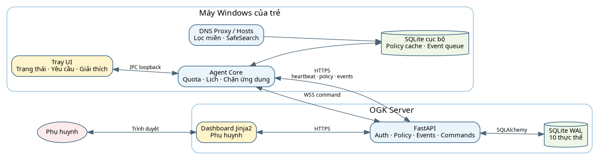
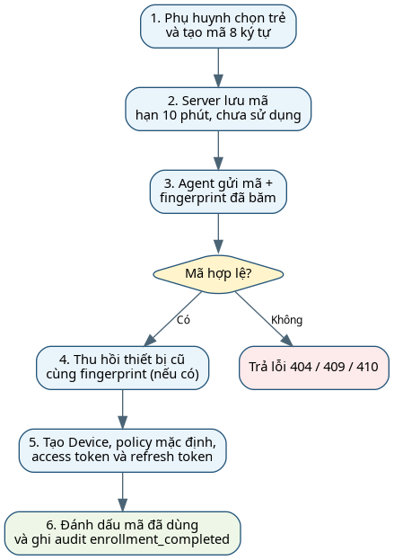
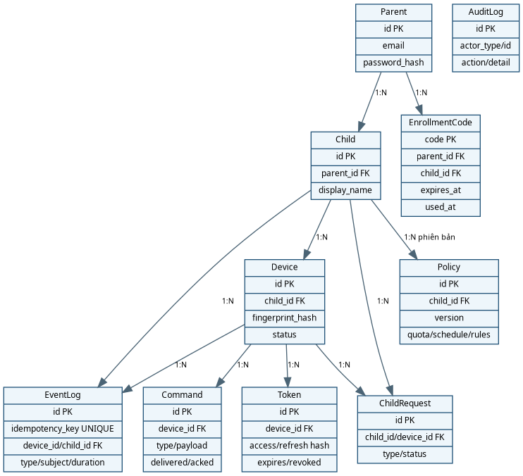
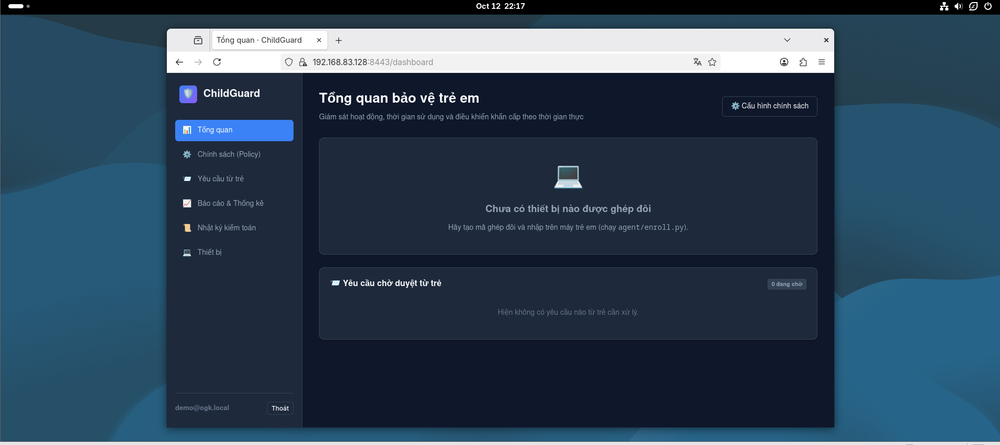
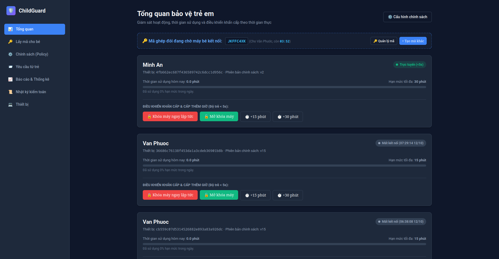
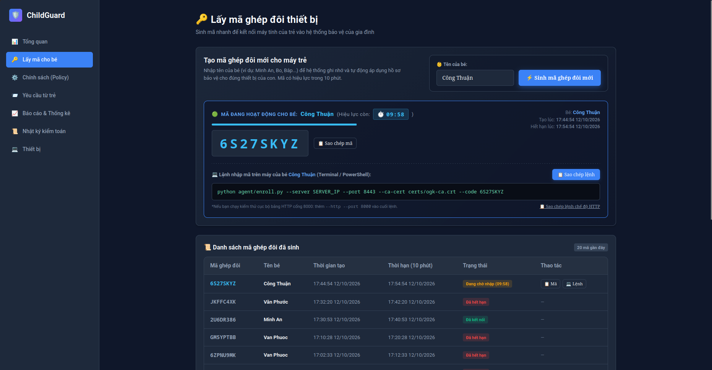
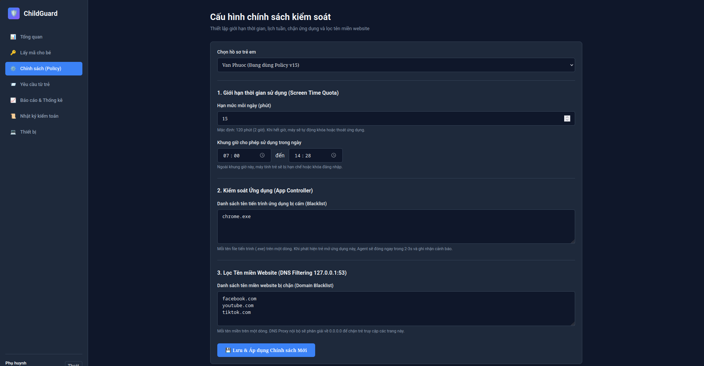
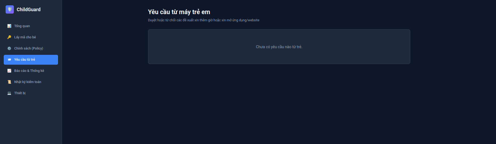
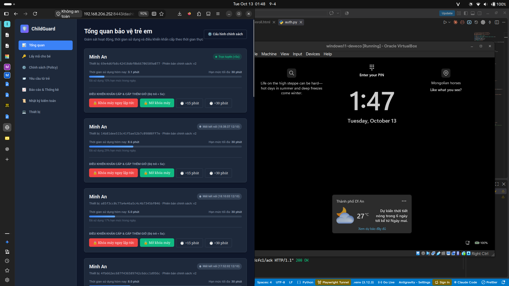

# TRƯỜNG ĐẠI HỌC KHOA HỌC TỰ NHIÊN, ĐHQG-HCM

## KHOA CÔNG NGHỆ THÔNG TIN

CHUYÊN ĐỀ TỐT NGHIỆP MẠNG MÁY TÍNH

# BÁO CÁO CHÍNH

## XÂY DỰNG ỨNG DỤNG HỖ TRỢ QUẢN LÝ VIỆC SỬ DỤNG MÁY TÍNH CỦA TRẺ EM

**Tên sản phẩm:** ChildGuard – An Open Guard Kids Application  
**Giảng viên hướng dẫn:** Đỗ Hoàng Cường  
**Nhóm:** [MÃ NHÓM] — **Lớp:** [TÊN LỚP]

| Sinh viên | MSSV |
|---|---|
| Nguyễn Văn Phước | 23120074 |
| Hà Công Thuận | 23120094 |

Thành phố Hồ Chí Minh, tháng 10 năm 2026

\pagebreak

# TÓM TẮT VÀ MỤC LỤC

## Tóm tắt đồ án

Máy tính ngày càng gắn liền với việc học tập và giải trí của trẻ, nhưng phụ huynh không phải lúc nào cũng có thể ở bên để hướng dẫn con sử dụng thiết bị đúng lúc và đúng mục đích. Nếu chỉ cấm đoán hoặc khóa máy một cách đột ngột, trẻ có thể không hiểu lý do, bị gián đoạn việc học và dễ tìm cách vượt qua giới hạn. Ngược lại, việc theo dõi quá chi tiết cũng có thể ảnh hưởng đến sự riêng tư và làm mất đi sự tin tưởng giữa trẻ với gia đình. Vì vậy, bài toán của đồ án không đơn thuần là “chặn” máy tính, mà là tạo ra một cách quản lý rõ ràng, có giải thích và cho phép phụ huynh đồng hành cùng trẻ.

ChildGuard – An Open Guard Kids Application được xây dựng để giải quyết vấn đề đó. Phụ huynh có thể thiết lập thời gian sử dụng, khung giờ trong tuần, những ứng dụng hoặc website cần hạn chế và theo dõi tình trạng máy trẻ từ một Dashboard. Trên máy của trẻ, hệ thống luôn hiển thị trạng thái bảo vệ, cảnh báo trước khi hết giờ, giải thích khi một nội dung bị chặn và cho phép trẻ gửi yêu cầu xin thêm thời gian. Khi mất kết nối mạng, các giới hạn cơ bản vẫn tiếp tục hoạt động và dữ liệu cần thiết sẽ được đồng bộ lại sau. ChildGuard chỉ ghi nhận những thông tin phục vụ quản lý như thời lượng, tên ứng dụng và tên miền; không đọc tin nhắn, nội dung gõ phím hay lưu lịch sử URL chi tiết. Qua đó, đồ án hướng đến một công cụ hỗ trợ gia đình hình thành thói quen sử dụng máy tính an toàn và cân bằng, thay vì một phần mềm giám sát bí mật.

**Từ khóa:** parental control, screen time, DNS proxy, SafeSearch, FastAPI, Windows Agent, WebSocket, quyền riêng tư.

## Mục lục

[MỤC LỤC TỰ ĐỘNG – trong Microsoft Word, chọn toàn bộ tài liệu và nhấn F9 để cập nhật]

## Danh mục hình, bảng và từ viết tắt

**Danh mục hình dự kiến:** Hình 3.1 Kiến trúc tổng thể; Hình 3.2 Luồng ghép đôi; Hình 3.3 Luồng đồng bộ; Hình 4.1–4.5 ảnh các màn hình chức năng; Hình 5.1 kết quả kiểm thử.

| Từ viết tắt | Giải thích |
|---|---|
| ACL | Access Control List – danh sách quyền truy cập |
| API | Application Programming Interface |
| CSRF | Cross-Site Request Forgery |
| DNS | Domain Name System |
| ERD | Entity–Relationship Diagram |
| HMAC | Hash-based Message Authentication Code |
| HTTP(S) | Hypertext Transfer Protocol (Secure) |
| IDOR | Insecure Direct Object Reference |
| IPC | Inter-Process Communication |
| OGK | Online Guardian Kit, tên nội bộ của ChildGuard |
| SHA-256 | Hàm băm Secure Hash Algorithm 256 bit |
| TLS | Transport Layer Security |
| UTC | Coordinated Universal Time |
| WebSocket | Kênh giao tiếp hai chiều thời gian thực trên TCP |

\pagebreak

# CHƯƠNG 1. TỔNG QUAN ĐỒ ÁN

## 1.1. Bối cảnh và vấn đề

Máy tính là công cụ học tập, giải trí và giao tiếp quen thuộc của trẻ em. Khó khăn của phụ huynh không chỉ nằm ở việc giới hạn tổng thời gian sử dụng mà còn ở việc thiết lập khung giờ phù hợp, hạn chế một số ứng dụng hoặc website và giải thích rõ cho trẻ vì sao một thao tác bị từ chối. Các biện pháp thủ công như nhắc nhở, tắt mạng hoặc theo dõi lịch sử trình duyệt thường thiếu nhất quán, khó áp dụng khi phụ huynh không ở cạnh máy và dễ xâm phạm quyền riêng tư nếu thu thập quá nhiều dữ liệu.

Đồ án đặt bài toán dưới góc nhìn một hệ thống phân tán nhỏ. Quyết định của phụ huynh được cấu hình trên Dashboard, lưu thành chính sách có phiên bản tại máy chủ và đồng bộ về Agent. Agent phải tiếp tục áp dụng chính sách đã nhận khi mạng gián đoạn, đồng thời đệm sự kiện để gửi lại sau. Khi trẻ cần ngoại lệ, giao diện Tray cho phép gửi yêu cầu xin thêm giờ thay vì tìm cách vượt qua cơ chế bảo vệ. Cách tiếp cận này cân bằng giữa khả năng kiểm soát của phụ huynh và sự minh bạch đối với trẻ.

ChildGuard không được định vị là phần mềm giám sát bí mật. Hệ thống không đọc nội dung tin nhắn, không ghi phím, không chụp màn hình và không lưu URL đầy đủ. Các log phục vụ báo cáo chỉ chứa loại sự kiện, thời điểm, thiết bị, trẻ, tên ứng dụng hoặc tên miền đăng ký và thời lượng khi phù hợp. Đây là ranh giới quan trọng để giảm rủi ro lạm dụng và giảm lượng dữ liệu nhạy cảm phải bảo vệ.

## 1.2. Mục tiêu và phạm vi

Mục tiêu chính là xây dựng nguyên mẫu chạy trên Windows 10/11 x64, có thể: ghép đôi máy trẻ với tài khoản phụ huynh; giới hạn thời gian theo ngày và ma trận lịch 7×48; bỏ qua thời gian khi máy khóa hoặc người dùng idle trên năm phút; cảnh báo trước khi hết thời gian; chặn ứng dụng và tên miền; đồng bộ chính sách; nhận lệnh khẩn; ghi sự kiện; hiển thị báo cáo; và tiếp nhận yêu cầu của trẻ. Sáu learning outcome trong đề bài bao phủ kiến trúc client–server, kiểm soát DNS/process, phân tích bypass, bảo mật và tối thiểu dữ liệu, liên hệ khung pháp lý Việt Nam, cùng khả năng đo lường và bảo vệ lựa chọn kỹ thuật khi vấn đáp.

Phạm vi máy chủ sử dụng FastAPI, SQLAlchemy và SQLite; giao diện phụ huynh render phía server bằng Jinja2; Agent viết bằng Python với psutil, pywin32, websockets và pystray. Môi trường mục tiêu là mô hình phòng lab: máy Windows của trẻ kết nối tới máy chủ Debian/Ubuntu qua HTTPS cổng 8443 với CA nội bộ. Hai thành viên thực hiện trong bốn tuần. Dự án chưa hướng tới phát hành thương mại, quản lý tập trung hàng nghìn thiết bị hay thay thế các cơ chế bảo vệ ở cấp hệ điều hành của nhà cung cấp.

Các tiêu chí định lượng trong đề bài được xem là mục tiêu nghiệm thu chứ không tự động là kết quả. Ví dụ, yêu cầu cập nhật chính sách không quá 60 giây, lệnh khẩn không quá 5 giây, sai số đếm giờ không quá ±30 giây/giờ và tỷ lệ chặn miền tối thiểu 95% chỉ được ghi là “đạt” khi có phép đo trên môi trường thật. Bộ mã hiện có kiểm thử tự động cho nhiều logic tương ứng, nhưng chưa có hồ sơ đo đủ 30 mẫu cho độ trễ, CPU, RAM và DNS.

## 1.3. Nguyên tắc thiết kế

Thứ nhất, hệ thống minh bạch: Tray UI hiện biểu tượng bảo vệ, thời gian còn lại, chính sách và lý do chặn. Thứ hai, dữ liệu được tối giản: event contract là enum đóng gồm chín loại; `subject` chỉ là tên file thực thi hoặc eTLD+1. Thứ ba, trẻ có quyền tương tác bằng yêu cầu xin thêm giờ và xem hoạt động hôm nay. Thứ tư, quyết định thay đổi chính sách và ghép đôi được ghi audit. Thứ năm, các miền cần thiết cho hoạt động hệ thống được đưa vào danh sách bypass cố định để tránh tự khóa kênh quản trị. Thứ sáu, Agent ưu tiên hoạt động ngoại tuyến bằng cache chính sách và hàng đợi SQLite.

Việc thử nghiệm phải dùng dữ liệu an toàn và có sự đồng ý. Tập phân loại “age_inappropriate” trong repository dùng các miền mô phỏng trung tính, không truy cập nội dung người lớn thật. Khi đánh giá trên máy Windows, tài khoản trẻ nên là standard user; quyền Administrator chỉ dành cho cài đặt, thay đổi DNS và gỡ bỏ phần mềm.

## 1.4. Phương pháp và bố cục

Nhóm triển khai theo vòng lặp phân tích yêu cầu, thiết kế hợp đồng dữ liệu, hiện thực từng lát dọc và bổ sung kiểm thử hồi quy. Git ghi nhận 43 commit tại thời điểm lập báo cáo, với hai tác giả chính. Chương 2 phân tích tác nhân và mức hoàn thành; Chương 3 mô tả kiến trúc, dữ liệu và bảo mật; Chương 4 trình bày hiện thực; Chương 5 đánh giá kiểm thử; Chương 6 tổng kết tổ chức nhóm, hạn chế và hướng phát triển. Báo cáo kỹ thuật mạng M1–M6 là tài liệu riêng và chỉ được dẫn chiếu trong báo cáo chính.

# CHƯƠNG 2. PHÂN TÍCH YÊU CẦU

## 2.1. Tác nhân và ca sử dụng

Hệ thống có ba vai trò logic. Phụ huynh đăng ký/đăng nhập, tạo hồ sơ trẻ, sinh mã ghép đôi, cấu hình quota–lịch–danh sách chặn, gửi lệnh, xử lý yêu cầu và xem báo cáo. Trẻ tương tác qua Tray UI để biết trạng thái, xem chính sách, xem hoạt động hôm nay và xin thêm giờ. Agent đại diện cho thiết bị đã ghép đôi, xác thực bằng access token để gửi heartbeat, nhận policy, tải event theo lô và ACK lệnh. Quản trị hệ thống chịu trách nhiệm cài máy chủ, chứng chỉ, sao lưu và vận hành; bản hiện tại chưa có mô hình tài khoản admin riêng.

Mô hình dữ liệu thực tế là một Parent có nhiều Child; một Child có nhiều Device. Tài liệu thiết kế từng mô tả quan hệ nhiều–nhiều giữa phụ huynh và trẻ nhưng model hiện tại dùng `children.parent_id`, do đó mỗi trẻ chỉ thuộc một phụ huynh. Báo cáo lấy mã nguồn làm chuẩn và coi tính năng đồng quản lý là hướng phát triển.

Luồng ghép đôi bắt đầu khi phụ huynh tạo mã tám ký tự có hiệu lực mười phút. Agent gửi mã và fingerprint đã băm. Server kiểm tra mã, thu hồi thiết bị cũ có cùng fingerprint, tạo thiết bị và cặp access/refresh token, đánh dấu mã đã dùng, tạo policy mặc định nếu cần và ghi audit. Access token có hạn mười phút, refresh token ba mươi ngày. Mã không tồn tại, hết hạn hoặc đã dùng lần lượt trả về 404, 410 và 409.

Luồng xin thêm giờ bắt đầu từ Tray/IPC. Agent tạo request gắn đúng device và child; server ghi thêm event `unlock_request`. Phụ huynh duyệt sẽ tạo command `grant_minutes`; nếu WebSocket đang kết nối, server đẩy ngay, nếu không Agent nhận qua heartbeat. Sau khi cộng thời gian, Agent hủy trạng thái ân hạn/khóa tương ứng và ACK lệnh.

## 2.2. Ma trận yêu cầu và nghiệm thu

| Nhóm | Nội dung | Trạng thái theo mã nguồn | Minh chứng |
|---|---|---|---|
| F1 | Quota ngày thường/cuối tuần; lịch 7×48; idle >5 phút; bỏ thời gian khóa; cảnh báo 10/5/1 phút; ân hạn 60 giây; chống lùi giờ | Phần lớn logic đã có; chưa thấy quota riêng ngày thường/cuối tuần và ngân sách theo nhóm ứng dụng | `agent/enforcer.py`, `agent/storage.py`, các test screen-time/schedule/warnings |
| F2 | Danh sách cho phép/chặn app kèm SHA-256; DNS proxy; SafeSearch; sáu nhóm/≥200 mục | Blacklist/hash/DNS/SafeSearch/200 mục đã có; allowlist bị chuẩn hóa về blacklist; DoH và khóa đổi DNS chưa hoàn chỉnh | `agent/dns_proxy.py`, `agent/enforcer.py`, CSV 200 mục |
| F3 | Event tối thiểu; hai giao diện báo cáo; 90 ngày; xóa hai phía; `PRIVACY.md` | Chức năng chính đã có; tên trường wire/storage khác nhẹ đề bài; thiếu `PRIVACY.md` | event contract, reports router, retention task, lệnh clear data |
| F4 | 1 phụ huynh:n trẻ:m thiết bị; policy version + integrity; ≤60 giây/≤5 giây; audit đầy đủ | Quan hệ/version/WebSocket/audit cơ bản đã có; thiếu HMAC/chữ ký, IP và old/new; chưa có phép đo | routers policy, heartbeat, commands; model Policy không có signature |
| F5 | Argon2id/scrypt; phiên an toàn; TLS/pinning; token 15 phút; AES-GCM; ba vai trò; ACL; STRIDE | Một phần, chưa đạt điều kiện tối thiểu để triển khai | token/TLS có; password/session/CSRF/authorization/encryption/STRIDE còn thiếu |

F1 có mức hoàn thiện tốt nhất ở phần logic. Agent dùng `time.monotonic()` để tính delta, theo dõi trạng thái workstation lock và idle, ghi bộ đếm vào SQLite, xác định quota còn lại và khung lịch hiện hành. Các mốc cảnh báo tạo event và thông báo; khi hết hạn, hệ thống cho 60 giây ân hạn lưu công việc trước khi khóa. Tuy nhiên policy hiện chỉ có `daily_minutes`, chưa biểu diễn quota riêng cho ngày thường và cuối tuần như yêu cầu bắt buộc của đề bài.

F2 kết hợp hai tầng lọc web. `HostsBlocker` cập nhật file hosts, còn `DNSProxyServer` lắng nghe cục bộ và trả phản hồi chặn hoặc phản hồi SafeSearch cho Google/Bing/YouTube. Danh sách bypass cố định bảo vệ các miền hạ tầng cần thiết. Chặn ứng dụng so khớp cả tên tiến trình và SHA-256; nhóm có logic chống đổi tên đơn giản và không cho chặn các tiến trình hệ thống thiết yếu. Tuy nhiên hiệu lực thực tế phụ thuộc quyền Windows, cấu hình DNS của card mạng và việc trình duyệt có dùng DoH riêng hay không.

F3 sử dụng Event Item v2 gồm chín loại. API cấm trường thừa, kiểm tra subject bắt buộc, chuẩn hóa tên miền và chống trùng bằng `idempotency_key`. Đề bài gọi các trường thời gian/chính sách là `ts` và `policy_id`, trong khi hiện thực dùng `created_at` và `policy_version`, đồng thời đặt idempotency key trong Event Item. Khác biệt này cần được giải thích hoặc chỉnh schema trước nghiệm thu. Báo cáo tổng hợp theo ngày/tuần, top ứng dụng và website bị chặn, nhóm website và xuất PDF. Tác vụ dọn dữ liệu quá 90 ngày chạy khi server khởi động và mỗi 24 giờ. Lệnh xóa dữ liệu xóa bản ghi server và yêu cầu Agent xóa queue/bộ đếm cục bộ.

F4 có policy version tăng dần, heartbeat và WebSocket; tuy nhiên policy chưa có HMAC/chữ ký số để Agent xác minh toàn vẹn. Heartbeat hiện mặc định 30 giây trong `SyncWorker`, khác mô tả thiết kế 60 giây nhưng vẫn nằm trong ngưỡng cập nhật. Command được đánh dấu delivered khi gửi; đường dự phòng heartbeat chỉ lấy lệnh chưa delivered, do đó cần kiểm tra lại trường hợp WebSocket gửi thành công nhưng Agent mất kết nối trước ACK.

F5 chưa đạt mức triển khai thực tế. Mật khẩu đang băm SHA-256 với salt tĩnh, không phải Argon2id/scrypt. `SESSION_SECRET` là hằng trong mã. Cookie có `HttpOnly` và `SameSite=Lax` nhưng chưa đặt `Secure`; không thấy token CSRF hoặc phiên server-side bị thu hồi khi logout. Access token hiện có hạn 10 phút thay vì 15 phút theo đề bài. Một số endpoint API phụ huynh như `/policy`, `/commands`, danh sách/xử lý requests và reports không khai báo dependency xác thực hoặc kiểm tra ownership. Chưa có AES-GCM cho trường nhạy cảm, ba vai trò parent/child-view/admin, rate limit theo IP, STRIDE tám mối đe dọa và checklist ASVS 20 mục. Đây là các khoảng trống phải sửa trước khi công bố hệ thống an toàn.

## 2.3. Ràng buộc và tham chiếu

Ràng buộc nền tảng gồm Windows 10/11 x64 cho Agent, Python 3.11 trở lên, quyền Administrator khi cài và cấu hình DNS, cùng máy chủ Linux có cổng 8443. SQLite phù hợp quy mô phòng lab, cài nhanh và hỗ trợ WAL, nhưng không thay thế cơ sở dữ liệu client–server khi có nhiều Agent đồng thời. Chứng chỉ lab do CA nội bộ ký giúp HTTPS xác minh hostname/IP; khóa riêng CA và server phải được giữ ngoài repository triển khai.

Các nguyên tắc quyền riêng tư trong tài liệu thiết kế được dùng như định hướng kỹ thuật, không phải kết luận pháp lý. Báo cáo chính không khẳng định tuân thủ một văn bản pháp luật khi chưa có bản `PRIVACY.md`, đánh giá pháp lý và quy trình thực tế về đồng ý, rút lại đồng ý, quyền truy cập/xóa dữ liệu. Tương tự, ghi chú “theo NIST” trong mã không đủ chứng minh tuân thủ nếu thuật toán băm và quản lý bí mật chưa phù hợp.

## 2.4. Phạm vi hoàn thành

Đã làm: ghép đôi một lần; thu hồi thiết bị trùng fingerprint; access/refresh token; heartbeat; cache policy; quota/lịch; idle/lock detection; cảnh báo/ân hạn; chặn app; DNS/hosts/SafeSearch; queue offline; event batch; WebSocket command; request; audit cơ bản; Dashboard; báo cáo ngày/tuần; PDF; retention; xóa hai phía; Tray UI; dữ liệu phân loại 200 mục; test logic.

Làm một phần: bảo mật tài khoản và phiên; ownership; tính toàn vẹn policy; cài Agent dạng Windows Service; ACL file cục bộ; phục hồi service; xử lý DoH/DoT; kiểm thử hiệu năng và độ trễ; tài liệu quyền riêng tư/mô hình đe dọa. Chưa thấy trong repository: `PRIVACY.md`, `THREATMODEL.md`, `AI_USAGE.md`, pipeline CI, bộ cài ký số và bằng chứng 15 phút trên máy sạch.

# CHƯƠNG 3. THIẾT KẾ HỆ THỐNG

## 3.1. Kiến trúc tổng thể

Kiến trúc gồm bốn khối. Trên máy trẻ, `PolicyEnforcer` áp quota/lịch và quét tiến trình; `DNSProxyServer`/`HostsBlocker` lọc tên miền; `AgentStorage` lưu cache và queue; `SyncWorker` trao đổi với server; `IPCServer` phục vụ Tray UI tại loopback. Tray chạy trong phiên người dùng để hiển thị thông tin, còn lõi cần quyền cao cho thao tác khóa máy và mạng. Ở phía server, FastAPI tiếp nhận API/WS, SQLAlchemy ánh xạ SQLite, Jinja2 dựng Dashboard. Phụ huynh truy cập Dashboard bằng trình duyệt.

| Kênh | Dữ liệu | Xác thực/bảo vệ hiện có |
|---|---|---|
| Agent–Server HTTPS | heartbeat, policy, events, ACK, request | Bearer access token; CA file |
| Agent–Server WSS | time sync và command | access token trong query hoặc header |
| Browser–Dashboard | form và HTML | cookie HMAC 12 giờ |
| Tray–Core loopback | status, notification, request | HTTP 127.0.0.1; cần rà soát token cục bộ |
| Core–SQLite | policy, event queue, quota | file cục bộ; ACL mới ở mức hướng dẫn |

Ranh giới tin cậy quan trọng nằm giữa Browser và Server, Agent và Server, Tray và tiến trình quyền cao, cũng như giữa người dùng thường và file cấu hình cục bộ. Việc chỉ bind IPC vào loopback giảm bề mặt mạng nhưng không tự động ngăn một tiến trình khác trên cùng máy gọi API; cần secret ngẫu nhiên hoặc named pipe có ACL trong bản hoàn thiện.

## 3.2. Vòng đời và giao thức

Enrollment dùng mã tám ký tự tránh các ký tự dễ nhầm. Fingerprint được tạo từ thông tin máy rồi băm tại Agent; server chỉ nhận giá trị băm. Thành công trả `device_id`, access token, refresh token, policy version và thời điểm hết hạn. Token thô chỉ trả một lần, server lưu SHA-256 của token.

Heartbeat gửi policy version, số giây quota đã dùng và số event đang chờ. Server cập nhật `last_seen_at`, so sánh policy version, trả danh sách command chưa giao và thời gian UTC. Nếu version khác, Agent gọi `GET /policy`. Event được flush độc lập theo lô tối đa 100 trong mã hiện tại; chỉ sau phản hồi thành công Agent mới xóa queue. Cơ chế này đạt at-least-once ở phía gửi và exactly-once logic ở server nhờ unique idempotency key.

WebSocket được dùng cho lệnh `lock`, `unlock`, `grant_minutes` và xóa dữ liệu. Agent reconnect sau năm giây và ACK qua HTTP lẫn frame WS. Heartbeat là kênh dự phòng. Điểm cần sửa là chỉ đánh dấu “delivered” không đủ đảm bảo đã thực thi; server nên gửi lại tới khi `acked_at` có giá trị, kèm giới hạn retry và xử lý command idempotent.

## 3.3. Mô hình dữ liệu

Các thực thể chính gồm Parent, Child, Device, EnrollmentCode, Token, Policy, Command, EventLog, ChildRequest và AuditLog. Policy được lưu theo phiên bản bất biến thay vì cập nhật tại chỗ, cho phép truy vết lịch sử. EventLog có unique idempotency key. Command có ba mốc created, delivered và acked. AuditLog hiện lưu actor type/id, action, JSON chi tiết và thời gian; chưa có cột IP và old/new value tách biệt như mẫu đề xuất.

Event Item trên đường truyền gồm `idempotency_key`, `type`, `subject`, `duration_sec`, `policy_version`, `created_at`. Chín type hợp lệ là `app_start`, `app_stop`, `domain_query`, `blocked_app`, `blocked_domain`, `quota_warning`, `locked`, `unlock_request`, `override_granted`. Với sự kiện ứng dụng, subject được chuẩn hóa thành basename; với web, subject thành eTLD+1 viết thường và bỏ scheme/path/query. Cách này ngăn Dashboard vô tình lưu lịch sử duyệt web chi tiết.

## 3.4. Thiết kế ngoại tuyến và thời gian

AgentStorage dùng SQLite WAL với ba bảng: cached_policy, event_queue và agent_state. Khi server mất kết nối, enforcer tiếp tục dùng policy cuối cùng, đồng thời ghi sự kiện vào queue. Khi có mạng, SyncWorker gửi lại. Policy mặc định chỉ dùng trước lần đồng bộ đầu; không nên dùng để tự mở mọi giới hạn.

Đồng hồ hệ thống có thể bị trẻ chỉnh lùi. Sau heartbeat/WS, Agent lưu timestamp server và mốc monotonic; thời gian hiện tại được suy ra từ phần tăng monotonic nên thay đổi RTC không làm quota tăng ngược. Bộ đếm chỉ cộng delta khi máy không khóa và idle không quá 300 giây. Khi Agent restart, mốc monotonic được tạo lại; ngày và số giây đã dùng vẫn nằm trong SQLite.

Tài liệu thiết kế đề xuất fail-closed có kiểm soát khi mất mạng dài ngày. Mã hiện có trường `in_degraded_mode`, nhưng chưa thấy đầy đủ hai giai đoạn ba/ngày–mười bốn/ngày và cơ chế unlock ký số. Vì vậy báo cáo ghi đây là quyết định thiết kế chưa hoàn thiện, không phải tính năng đã nghiệm thu.

## 3.5. Thiết kế bảo mật và quyền riêng tư

Điểm tích cực gồm token ngẫu nhiên bằng `secrets`, chỉ lưu hash token trên server, access token ngắn hạn, refresh token có thu hồi, kiểm tra device status, CA nội bộ cho TLS, chuẩn hóa event, event enum đóng và giới hạn dữ liệu. Đăng nhập có khóa 15 phút sau năm lần sai, session hết hạn 12 giờ. Enrollment ghi audit như dấu vết đồng ý ở mức hệ thống.

Rủi ro ưu tiên cao gồm băm mật khẩu nhanh và salt tĩnh; secret session hard-code; cookie thiếu Secure; API phụ huynh thiếu xác thực/ownership; JSON audit được ghép chuỗi ở vài chỗ; khóa CA/server đang hiện diện trong workspace; IPC loopback chưa chứng minh có xác thực; không có HMAC policy; và chưa có CSRF. Kế hoạch khắc phục là Argon2id/scrypt với salt ngẫu nhiên, secret từ environment/secret store, cookie Secure, CSRF token, dependency `get_current_parent` cho mọi endpoint, filter theo `parent.id`, policy signature, ACL thực tế và loại khóa riêng khỏi kho mã.

# CHƯƠNG 4. HIỆN THỰC HỆ THỐNG

## 4.1. Môi trường và cấu trúc mã nguồn

Phiên bản khảo sát dùng Python 3.12.3 trong môi trường hiện tại; requirements chấp nhận Python 3.11+. Server phụ thuộc FastAPI, Pydantic, SQLAlchemy, Uvicorn, HTTPX, Jinja2 và publicsuffix2. Agent phụ thuộc psutil, websockets, pystray, Pillow, publicsuffix2 và pywin32 trên Windows.

| Thư mục | Vai trò |
|---|---|
| `agent/` | ghép đôi, lưu cục bộ, enforcer, DNS, IPC, sync và Tray UI |
| `server/app/` | model, schema, security, dependency và router FastAPI |
| `dashboard/` | template Jinja2 và CSS |
| `server/data/` | danh sách miền mặc định và CSV phân loại |
| `tests/` | 13 tệp test, 110 hàm test |

Commit dùng làm mốc báo cáo là `96337fa` trên nhánh main. Repository có 43 commit; `git shortlog` ghi 22 commit của Nguyễn Văn Phước và 21 commit của tài khoản HathUan14. Số commit chỉ là dấu vết tham khảo, không được dùng một mình để kết luận tỷ lệ đóng góp.

## 4.2. Agent và các cơ chế kiểm soát

`run_agent.py` kiểm tra quyền Administrator, tải state hoặc thực hiện enrollment, sau đó khởi tạo storage, enforcer, DNS, IPC và sync. Enforcer dùng vòng lặp tick để cập nhật thời gian, so lịch/quota, phát cảnh báo và khóa workstation. Quét process dùng psutil; hash file được cache để giảm chi phí. Một baseline được tạo khi Agent bắt đầu để tránh phát sai hàng loạt sự kiện `app_start` cho các tiến trình có trước.

Chặn app dùng blacklist. Mỗi rule có thể là tên, hash hoặc cặp tên:hash. Việc so hash giúp nhận diện file bị đổi tên; tên giúp cấu hình dễ dùng. Danh sách tiến trình hệ thống thiết yếu luôn được bảo vệ. Khi chặn, Agent kill tiến trình, ghi `blocked_app` và hiển thị popup có lý do; cơ chế chống spam giới hạn thông báo cùng đối tượng trong tám giây.

DNS proxy parse QNAME, chuẩn hóa domain, kiểm tra bypass, SafeSearch và blacklist. Tầng hosts giúp chặn cả khi proxy chưa xử lý được một số đường đi; đổi DNS card mạng về 127.0.0.1 là bước triển khai bắt buộc. Giới hạn: DoH trong trình duyệt có thể bỏ qua DNS hệ điều hành; lọc theo domain không phân biệt URL/path; một IP có thể phục vụ nhiều domain.

IPC cung cấp status, notifications, policy, hoạt động hôm nay và endpoint gửi request. Tray UI hiển thị đồng hồ, chính sách, thông báo và nút xin 15/30/60 phút. Đây là thành phần thể hiện nguyên tắc minh bạch, nhưng cần chạy trong đúng user session thay vì tiến trình service LocalSystem.

## 4.3. Server và Dashboard

Server khởi tạo schema, chạy migration nhẹ, dọn retention và đăng ký router. Dashboard có màn hình đăng nhập/đăng ký, tổng quan, ghép đôi, chính sách, yêu cầu, báo cáo, nhật ký, trạng thái thiết bị và “Hôm nay em đã dùng gì”. Jinja2 giảm phụ thuộc build frontend, phù hợp tiêu chí cài nhanh. Policy page nhập quota, giờ bắt đầu/kết thúc, ma trận lịch, app và domain; mỗi lần lưu tạo một Policy version mới và AuditLog.

Reports router quy đổi UTC sang múi giờ báo cáo, tổng hợp theo giờ/ngày/tuần, đếm top 10 app/web bị chặn, phân loại website, cung cấp recent events và xuất PDF. CSV có đúng 200 dòng dữ liệu: 60 education, 40 entertainment, 30 social_network, 30 gaming, 20 age_inappropriate mô phỏng và 20 unclassified. Danh sách mặc định chặn có 15 domain.

Các ảnh dưới đây là preview từ một phiên bản cũ do nhóm cung cấp. Chúng minh họa luồng chức năng, không được xem là bằng chứng giao diện của commit cuối; trước khi nộp cần chụp lại cùng dữ liệu demo nhất quán và che token, mã ghép đôi hoặc định danh không cần thiết.

## 4.4. Các luồng minh họa

Ghép đôi: phụ huynh chọn trẻ và tạo mã; Agent nhập mã; server trả token; Dashboard thấy thiết bị. Kết quả mong đợi là mã chỉ dùng một lần, hết hạn sau mười phút và có audit `enrollment_completed`.

Đổi luật: phụ huynh lưu quota/lịch/blacklist; server tạo version mới; heartbeat báo `policy_changed`; Agent tải, cache và áp dụng. Kết quả mong đợi là version tăng đúng một và thay đổi tới máy trong ngưỡng đo được.

Chặn miền: truy vấn tới miền blacklist đi qua DNS/hosts; Agent từ chối, phát popup và tạo event `blocked_domain` với eTLD+1. Không lưu URL đầy đủ. Với Google/Bing/YouTube và SafeSearch bật, proxy trả đích SafeSearch tương ứng.

Xin thêm giờ: trẻ chọn số phút trong Tray; request xuất hiện trên Dashboard; phụ huynh approve; command gửi qua WebSocket/heartbeat; Agent cộng quota và ACK. Từ chối chỉ đổi trạng thái request, không phát command.

Xóa dữ liệu: phụ huynh yêu cầu purge; server xóa event/request liên quan và tạo command clear; Agent xóa event queue và reset quota/lock. Cần chụp bằng chứng cả server lẫn Agent để chứng minh xóa hai phía.

# CHƯƠNG 5. KIỂM THỬ VÀ ĐÁNH GIÁ

## 5.1. Môi trường và phương pháp kiểm thử

Lần kiểm tra phục vụ báo cáo chạy ngày 19/10/2026 tại `/opt/childguard/app`, Python 3.12.3, pytest 9.1.1 trên Linux. Test dùng SQLite tạm và override dependency database, không sửa database thật. Bộ test khai báo 110 ca trong 13 file, vượt yêu cầu số lượng tối thiểu. Ngoài unit test, nhiều test dùng FastAPI TestClient để kiểm tra luồng API/Dashboard.

Lệnh `python -m pytest -vv -x` thu thập đủ 110 ca. Bảy ca đầu của `test_app_enforcer.py` pass; ca thứ tám `test_dashboard_always_saves_blacklist_policy` không kết thúc trong 20 giây và bị `timeout` trả mã 124. Vì test suite chạy tuần tự, chưa có tổng số pass/fail đáng tin cậy cho toàn bộ bộ test. Đây là lỗi hạ tầng/test hoặc deadlock cần điều tra, không được chuyển thành “110/110 pass”.

Kiểm thử Windows thật cần một VM Windows 10/11 standard user, một server Debian, CA lab, card mạng dùng DNS 127.0.0.1 và trình duyệt cấu hình kiểm soát DoH. Mỗi phép đo độ trễ nên lặp ít nhất 30 lần, lưu raw CSV, tính p50/p95 và mô tả cấu hình CPU/RAM/mạng.

## 5.2. Bảng kiểm thử chức năng

| Mã | Kịch bản | Trạng thái hiện có | Việc cần bổ sung |
|---|---|---|---|
| T01 | Khóa ngoài lịch trong 5 giây | Có unit test mô phỏng | video/timestamp Windows thật |
| T02 | Sai số ≤±30 giây mỗi giờ | Có test monotonic | chạy một giờ thật, 30 mẫu nếu yêu cầu |
| T03 | Lùi đồng hồ ba giờ không tăng quota | Có test server-time/RTC | bằng chứng VM |
| T04 | Đổi tên notepad vẫn nhận diện bằng hash | Có test mock/hash | thử executable an toàn trên Windows |
| T05 | Chặn ≥95% 50 miền; 0 false positive/20 giáo dục | Chưa có bộ kết quả đo | tạo danh sách công khai an toàn |
| T06 | SafeSearch bằng nslookup và browser | Có test packet/logic | chụp nslookup và trình duyệt |
| T07 | Policy ≤60 giây; command ≤5 giây | Kiến trúc hỗ trợ | đo p50/p95 30 lần |
| T08 | Từ chối cert/chữ ký/khác chủ | Token/cert một phần; signature/ownership thiếu | sửa rồi pentest |
| T09 | Xóa server và cache Agent | Có test luồng | xác nhận trên hai DB thật |

Các nhóm test bao phủ enrollment/token, heartbeat, command/ACK, policy, events idempotency, request, authentication/dashboard, report/retention/PDF, schedule, warning/grace, screen time, process hash và DNS/SafeSearch. Tuy nhiên test pass trên Linux không chứng minh các API Windows như `LockWorkStation`, idle detection, UAC, file hosts, UDP/53 và pystray hoạt động trong service/session thực tế.

## 5.3. Đánh giá kỹ thuật mạng

Giao thức dùng HTTPS/WSS tới cổng 8443, access token trong Bearer header cho HTTP và query/header cho WS. Heartbeat định kỳ kết hợp WebSocket tạo hai kênh: kênh realtime cho độ trễ thấp và kênh polling dự phòng. Event batch giảm số request khi online trở lại. SQLite WAL cải thiện khả năng đọc/ghi đồng thời ở quy mô nhỏ.

Chưa có dữ liệu thực nghiệm CPU/RAM, DNS p50/p95, overhead của hash process và độ trễ policy/command. Báo cáo kỹ thuật M1–M6 phải trình bày topology, capture gói tin đã ẩn token, timeout/retry, DNS behavior, TLS verification và phép đo. Không nên capture hoặc đưa access/refresh token thật vào phụ lục.

## 5.4. Hạn chế và thảo luận

Hạn chế chức năng: Agent chủ yếu là chương trình Python chạy quyền cao, chưa chứng minh đóng gói Windows Service có recovery; lọc domain không chống mọi DoH/DoT/VPN; standard user có thể dùng phần mềm portable hoặc proxy; hash file tốn tài nguyên nếu cache không hiệu quả; SQLite không phù hợp tải lớn; quan hệ phụ huynh–trẻ chỉ một–nhiều.

Hạn chế bảo mật: các API quản trị trực tiếp thiếu xác thực và ownership; session secret/salt hard-code; password SHA-256; thiếu policy signature, CSRF, secure cookie và threat model chính thức; khóa riêng TLS có trong workspace hiện tại. Đây là hạn chế nghiêm trọng, nên chỉ demo trong mạng lab có kiểm soát cho đến khi sửa.

Hạn chế bằng chứng: test suite đang treo; chưa có ảnh màn hình trong báo cáo; chưa có raw measurement; chưa xác minh cài đặt 15 phút; chưa có tài liệu pháp lý và đánh giá người dùng. Kết luận phù hợp là “nguyên mẫu có phần lớn luồng chức năng”, không phải sản phẩm production-ready.

# CHƯƠNG 6. TỔ CHỨC NHÓM VÀ KẾT LUẬN

## 6.1. Phân công và tiến độ

| Tuần | Đầu việc/đầu ra | Người làm và minh chứng |
|---|---|---|
| 1 | Kiến trúc; môi trường; database; auth; heartbeat | Nguyễn Văn Phước/Hà Công Thuận – cần xác nhận người phụ trách và commit |
| 2 | quota, lịch, screen time, policy, đồng bộ | Nguyễn Văn Phước/Hà Công Thuận – cần xác nhận người phụ trách |
| 3 | app/DNS/SafeSearch, event, báo cáo, Tray | Nguyễn Văn Phước/Hà Công Thuận – cần xác nhận người phụ trách |
| 4 | bảo mật, bypass, đo lường, tài liệu, demo | Nguyễn Văn Phước/Hà Công Thuận – cần xác nhận người phụ trách |

Git ghi nhận hai tác giả có số commit gần cân bằng (22 và 21), nhưng cần đối chiếu nội dung commit, thời gian làm việc, kiểm thử, tài liệu và phối hợp. Nhóm nên điền tên thật thay vì tài khoản Git, gắn commit/PR tiêu biểu và thống nhất tỷ lệ trước khi nộp.

## 6.2. Tự đánh giá đóng góp

| Thành viên | Hạng mục và minh chứng | Tỷ lệ |
|---|---|---|
| Nguyễn Văn Phước – 23120074 | [Module, commit, test, phần báo cáo] | [x%] |
| Hà Công Thuận – 23120094 | [Module, commit, test, phần báo cáo] | [100−x%] |

Mỗi thành viên cần mô tả phần trực tiếp hiện thực, phần phối hợp, kết quả chưa hoàn thành và kiến thức học được. Tổng tỷ lệ phải bằng 100%. Không dùng số commit làm thước đo duy nhất vì một commit có thể là sửa nhỏ hoặc một tính năng lớn.

## 6.3. Kết luận và hướng phát triển

ChildGuard đã hình thành một nguyên mẫu end-to-end với Agent, Server và Dashboard. Các điểm nổi bật là kiểm soát thời gian có idle/lock và monotonic clock, chặn app bằng tên/SHA-256, DNS/SafeSearch, cache ngoại tuyến, event contract tối giản, command WebSocket, yêu cầu xin thêm giờ, báo cáo và retention. Cấu trúc module tương đối rõ, bộ test rộng và tài liệu thiết kế mô tả được các quyết định chính.

Mức hoàn thành chưa đồng đều. F1–F3 đạt phần lớn logic; F4 thiếu chữ ký policy và cần sửa semantics retry command; F5 mới là nền tảng và còn lỗ hổng authorization, password/session/CSRF. Test suite hiện treo ở một integration test và thiếu phép đo Windows thật. Do đó mục tiêu ngắn hạn là sửa bảo mật P0, làm test chạy ổn định, thu thập bằng chứng và hoàn thiện tài liệu bắt buộc.

Hướng phát triển ưu tiên: (1) bắt buộc auth/ownership trên mọi endpoint; (2) Argon2id, secret rotation, CSRF và secure cookie; (3) HMAC/chữ ký policy và mã hóa secret cục bộ; (4) đóng gói Windows Service + installer ký số + recovery; (5) kiểm soát DoH/VPN trong phạm vi được phép; (6) PostgreSQL và migration chuẩn nếu mở rộng; (7) CI trên Linux và Windows; (8) accessibility và nghiên cứu trải nghiệm trẻ/phụ huynh có đồng ý đạo đức.

# TÀI LIỆU THAM KHẢO VÀ ĐỐI CHIẾU HỒ SƠ NỘP

[1] Nhóm phát triển ChildGuard, “ChildGuard (OGK) — Thiết kế Kiến trúc Hệ thống”, phiên bản 0.2, tệp `ChildGuard-Design.md`, truy cập 19/10/2026.  
[2] Nhóm phát triển ChildGuard, mã nguồn tại commit `96337fa`, nhánh main, truy cập 19/10/2026.  
[3] FastAPI, “FastAPI Documentation”, https://fastapi.tiangolo.com/, cần ghi ngày truy cập khi chốt bản nộp.  
[4] SQLAlchemy, “SQLAlchemy Documentation”, https://docs.sqlalchemy.org/, cần ghi ngày truy cập khi chốt bản nộp.  
[5] Python Software Foundation, “Python Documentation”, https://docs.python.org/3/, cần ghi ngày truy cập khi chốt bản nộp.  
[6] Microsoft, tài liệu Windows Service, LockWorkStation và DNS Client, cần bổ sung đúng URL trang đã sử dụng.  
[7] IETF, RFC 8446 “The Transport Layer Security (TLS) Protocol Version 1.3”, 2018.  
[8] NIST, SP 800-63B “Digital Identity Guidelines: Authentication and Lifecycle Management”, cần xác minh phiên bản hiện hành trước khi nộp.  
[9] Khoa Công nghệ Thông tin, Trường Đại học Khoa học Tự nhiên, ĐHQG-HCM, “Đồ án môn học – OpenGuard Kids: Xây dựng ứng dụng hỗ trợ quản lý việc sử dụng máy tính của trẻ em”, 13 trang, 2026.

| Hồ sơ | Trạng thái tại thời điểm lập báo cáo |
|---|---|
| Báo cáo chính 20–30 trang | Đã tạo bản nháp; cần thông tin bìa, ảnh và cập nhật mục lục |
| Báo cáo kỹ thuật mạng M1–M6 | Nhóm tự hoàn thiện/đính kèm riêng |
| `PRIVACY.md` | Chưa thấy trong repository |
| `THREATMODEL.md` | Chưa thấy trong repository |
| `AI_USAGE.md` | Chưa thấy trong repository |
| Mã nguồn và tests | Có; 110 test khai báo, suite đang treo tại một test Dashboard |
| README và demo video | Có hướng dẫn rời; chưa có bằng chứng cài 15 phút/video 5–7 phút |

## Các trường cần hoàn thiện trước khi nộp

1. Điền mã nhóm và tên lớp.
2. Chụp lại giao diện bản mới, thay các ảnh preview và bổ sung ảnh Tray UI/kết quả test.
3. Điều tra test treo, chạy lại toàn bộ và thay số liệu trong Chương 5.
4. Điền phân công, tỷ lệ đóng góp và commit minh chứng.
5. Bổ sung URL tài liệu chính thức; tự kiểm chứng mọi nhận định pháp lý.
6. Hoàn thiện `PRIVACY.md`, `THREATMODEL.md`, `AI_USAGE.md`, báo cáo M1–M6, README và video.
7. Cập nhật mục lục/danh mục hình trong Word bằng F9 và kiểm tra số trang cuối.
