# ChildGuard — Chức năng đã thực hiện và luồng hoạt động trong mã nguồn

> Tài liệu này mô tả hành vi của phiên bản mã nguồn hiện tại, không chỉ mô tả thiết kế dự kiến.  
> Mốc đối chiếu: nhánh `main`, commit được dùng trong báo cáo `96337fa`.  
> Nguồn: `ChildGuard-Design.md`, mã nguồn trong `agent/`, `server/`, `dashboard/` và các test trong `tests/`.

## 1. Phạm vi và kiến trúc đang được hiện thực

ChildGuard gồm ba phần chính:

1. **Agent trên máy Windows của trẻ**: áp dụng chính sách, đếm thời gian, khóa máy, chặn ứng dụng, lọc DNS, lưu sự kiện ngoại tuyến và hiển thị Tray UI.
2. **OGK Server**: cung cấp API FastAPI, xác thực thiết bị/phụ huynh, lưu policy, event, command, request và dữ liệu báo cáo trong SQLite.
3. **Dashboard**: giao diện Jinja2 để phụ huynh ghép đôi thiết bị, thay đổi chính sách, gửi lệnh, xử lý yêu cầu và xem báo cáo.

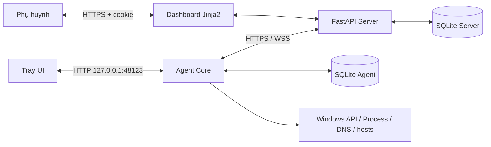

### 1.1. Các tiến trình được khởi động trên Agent

Điểm vào chính là `agent/run_agent.py:main()`.

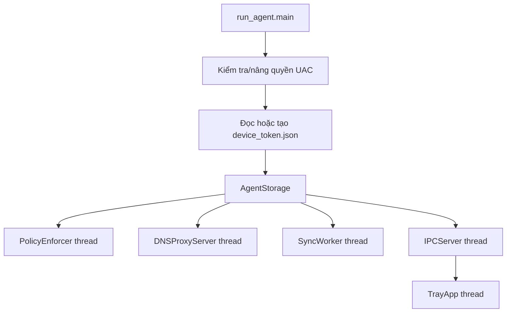

Các bước cụ thể trong code:

- `ensure_admin()` kiểm tra quyền Administrator và dùng `ShellExecuteW(..., "runas", ...)` để yêu cầu UAC trên Windows.
- `HostsBlocker.setup_permissions()` chuẩn bị quyền ghi file hosts.
- `AgentStorage()` tạo database `agent_state/agent.db` và các bảng `cached_policy`, `event_queue`, `agent_state`.
- `PolicyEnforcer.run_loop()` chạy mặc định mỗi hai giây.
- `DNSProxyServer.start()` cố bind UDP `127.0.0.1:53`.
- `SyncWorker.run_heartbeat_loop()` mở luồng heartbeat, WebSocket và đồng bộ event.
- `IPCServer.start()` mở HTTP cục bộ tại `127.0.0.1:48123`.
- `TrayApp.run()` khởi tạo biểu tượng khay hệ thống và các cửa sổ dành cho trẻ.

Nếu DNS proxy không bind được cổng 53, Agent vẫn giữ lớp chặn bằng file hosts. Khi nhận SIGINT/SIGTERM, `shutdown()` dừng Tray, Enforcer, DNS, Sync và IPC; `DNSProxyServer.stop()` đồng thời dọn khối ChildGuard khỏi file hosts.

## 2. Bảng tổng hợp chức năng

| STT | Chức năng | Trạng thái trong code | Module chính |
|---:|---|---|---|
| 1 | Đăng ký, đăng nhập phụ huynh | Đã có; bảo mật mật khẩu/phiên còn hạn chế | `server/app/routers/auth.py`, `security.py` |
| 2 | Sinh mã và ghép đôi thiết bị | Đã có | `dashboard.py`, `enroll.py`, `agent/enroll.py` |
| 3 | Token thiết bị và tự làm mới | Đã có | `auth.py`, `deps.py`, `agent/sync.py` |
| 4 | Heartbeat và đồng bộ thời gian | Đã có | `heartbeat.py`, `agent/sync.py`, `storage.py` |
| 5 | Tạo và đồng bộ policy | Đã có; chưa có HMAC/chữ ký | `dashboard.py`, `heartbeat.py`, `storage.py` |
| 6 | Quota, lịch 7×48, idle, khóa máy | Đã có | `agent/enforcer.py`, `storage.py` |
| 7 | Cảnh báo 10/5/1 phút và ân hạn | Đã có | `agent/enforcer.py`, `ipc.py`, `tray_app.py` |
| 8 | Chặn ứng dụng theo tên/SHA-256 | Đã có, chỉ dùng blacklist | `agent/enforcer.py` |
| 9 | Chặn website và SafeSearch | Đã có hai lớp DNS + hosts | `agent/dns_proxy.py` |
| 10 | Hàng đợi event ngoại tuyến | Đã có | `agent/storage.py`, `agent/sync.py`, `events.py` |
| 11 | Lệnh khẩn WebSocket | Đã có | `commands.py`, `agent/sync.py` |
| 12 | Trẻ xin thêm giờ | Đã có | `tray_app.py`, `ipc.py`, `requests.py` |
| 13 | Tray UI và màn hình minh bạch | Đã có | `agent/tray/tray_app.py`, `ipc.py` |
| 14 | Báo cáo, phân loại website, PDF | Đã có | `reports.py`, `domain_categories.py` |
| 15 | Retention 90 ngày và xóa hai phía | Đã có | `main.py`, `reports.py`, `dashboard.py`, `sync.py` |
| 16 | Audit log | Đã có ở mức cơ bản | `models.py` và các router |

## 3. Đăng ký và đăng nhập phụ huynh

### 3.1. Luồng đăng ký

Điểm vào: `POST /auth/register` hoặc form `/dashboard/register`.

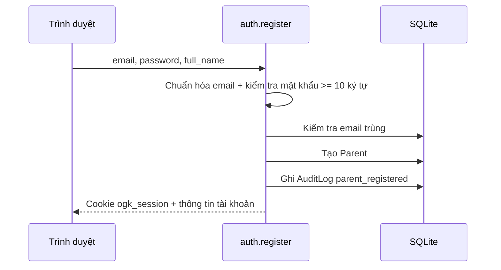

Các hàm liên quan:

- `security.validate_password_strength()` yêu cầu tối thiểu 10 ký tự.
- `security.hash_password()` tạo giá trị băm lưu vào `Parent.password_hash`.
- `security.create_parent_session(parent.id, hours=12)` tạo session HMAC có thời hạn 12 giờ.
- Cookie `ogk_session` được đặt `HttpOnly` và `SameSite=Lax`.

### 3.2. Luồng đăng nhập

1. `auth.login()` tìm `Parent` theo email đã chuẩn hóa.
2. Nếu `locked_until` còn hiệu lực, API trả `403`.
3. `security.verify_password()` so sánh mật khẩu bằng `hmac.compare_digest`.
4. Mỗi lần sai tăng `failed_login_attempts`; lần sai thứ năm khóa tài khoản 15 phút.
5. Đăng nhập đúng reset bộ đếm, tạo session 12 giờ, ghi `parent_login` vào audit và đặt cookie.
6. `get_optional_parent()` hoặc `get_current_parent()` đọc cookie/header, xác minh chữ ký session rồi tải Parent.

**Giới hạn hiện tại:** mật khẩu vẫn dùng SHA-256 với salt tĩnh, session secret được hard-code, cookie chưa đặt `Secure`, logout chỉ xóa cookie phía trình duyệt và chưa có kho phiên server-side để thu hồi. Chưa thấy CSRF token và rate limiting được hiện thực.

**Kiểm thử liên quan:** `tests/test_auth_dashboard.py`.

## 4. Sinh mã và ghép đôi thiết bị

### 4.1. Phía phụ huynh

Dashboard tạo `EnrollmentCode` gắn với `parent_id` và `child_id`. Mã có tám ký tự, tránh các ký tự dễ nhầm và hết hạn sau 10 phút. Giao diện hiển thị trạng thái đang chờ, đã dùng hoặc hết hạn.

### 4.2. Phía Agent

`agent/enroll.py` thực hiện:

1. `get_machine_guid()` đọc `MachineGuid` trong Windows Registry.
2. `compute_fingerprint()` băm `SHA256(machine_guid:hostname)`; dữ liệu thô không được gửi lên server.
3. `call_enroll()` gọi `POST /enroll` với mã và fingerprint.
4. `save_state()` lưu `device_id`, access token, refresh token, thời hạn token, địa chỉ server và port vào `agent_state/device_token.json`.

`run_agent.py` cũng cho phép nhập mã ngay khi chưa có state hoặc khi chạy với `--pair`.

### 4.3. Phía Server

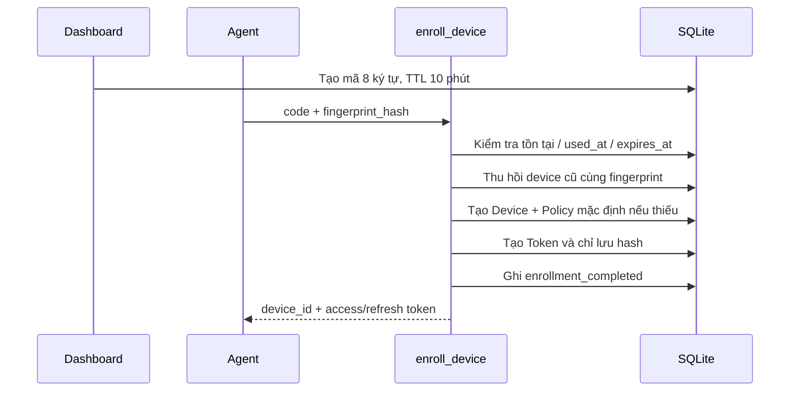

`server/app/routers/enroll.py:enroll_device()` trả:

- `404 invalid_code` nếu mã không tồn tại.
- `409 code_already_used` nếu mã đã dùng.
- `410 code_expired` nếu mã hết hạn.

Khi cùng fingerprint ghép đôi lại, server chuyển thiết bị cũ sang `revoked` và thu hồi toàn bộ token cũ. Nếu trẻ chưa có policy, `security.default_policy_payload()` tạo quota mặc định 120 phút, app blacklist rỗng, danh sách domain mặc định và SafeSearch bật.

**Kiểm thử liên quan:** `tests/test_enroll.py`, các luồng tích hợp trong `tests/test_auth_dashboard.py`.

## 5. Xác thực thiết bị và làm mới access token

Mọi endpoint Agent như heartbeat, policy, event và ACK dùng dependency `get_current_device()`:

1. Đọc `Authorization: Bearer <access_token>`.
2. Băm token bằng SHA-256.
3. Tìm bản ghi `Token.access_token_hash`.
4. Từ chối token không tồn tại, bị revoke hoặc hết hạn.
5. Tải `Device` và kiểm tra `status == "active"`.

Access token hiện có TTL 10 phút; refresh token có TTL 30 ngày.

Khi `_http_request()` nhận HTTP `401/403`, hoặc token gần hết hạn trong 120 giây, `SyncWorker._refresh_access_token()` gọi `POST /auth/refresh`. Server kiểm tra hash refresh token, thời hạn và trạng thái Device, sau đó thay access token cũ bằng token mới. Agent ghi state theo cách atomic: ghi file `.tmp` rồi `replace()` file chính.

**Lưu ý:** nếu không tìm thấy CA file, `agent/enroll.py` và `SyncWorker` hiện có đường fallback dùng SSL context không xác minh. Đây là tiện ích phát triển nhưng cần chuyển thành fail-closed trước khi triển khai thật.

## 6. Heartbeat, trạng thái online và đồng bộ thời gian

Điểm vào Agent: `SyncWorker.send_heartbeat()`; điểm vào Server: `POST /heartbeat`.

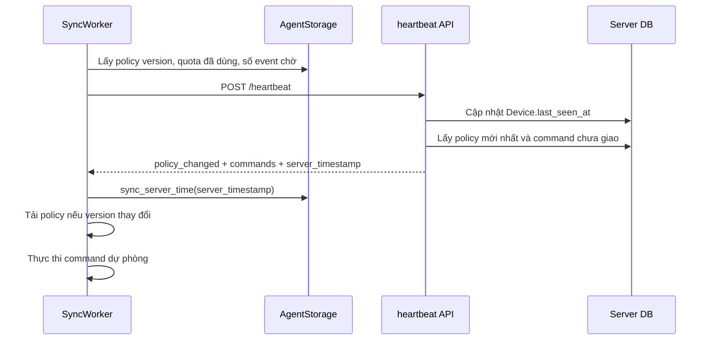

`AgentStorage.sync_server_time()` neo thời gian server vào `time.monotonic()`. Sau đó:

```text
server_time_now = synced_server_timestamp + (monotonic_now - sync_monotonic)
```

Cách này giúp việc tạo timestamp, đổi ngày quota và kiểm tra lịch không bị kéo lùi chỉ vì người dùng sửa RTC Windows.

Trong code hiện tại, `run_heartbeat_loop(interval=30)` chạy mặc định mỗi 30 giây, dù docstring/tài liệu thiết kế vẫn ghi 60 giây.

**Kiểm thử liên quan:** `tests/test_heartbeat.py`, `tests/test_screen_time_sync.py`.

## 7. Tạo, lưu và đồng bộ chính sách

### 7.1. Phụ huynh lưu policy

Form `POST /dashboard/policy/save` nhận:

- `daily_minutes`;
- `start_time`, `end_time`;
- `schedule_matrix` dạng JSON;
- `blocked_apps`;
- `blocked_domains`;
- trạng thái `safesearch`.

Router thực hiện:

1. Chuẩn hóa từng rule ứng dụng bằng `security.parse_app_rule_entry()`.
2. Chuẩn hóa domain về dạng không có `http(s)://`, path và port.
3. Kiểm tra ma trận bằng `validate_or_normalize_matrix()`; nếu không hợp lệ thì sinh ma trận từ start/end time.
4. Lấy policy mới nhất và tăng `version` thêm một.
5. Lưu bốn JSON: quota, schedule, app rules và domain rules.
6. Ghi `policy_updated` vào AuditLog.

App rules luôn được lưu ở chế độ `blacklist`; giá trị whitelist từ client cũ bị bỏ qua.

### 7.2. Agent nhận policy

1. Heartbeat so sánh version Agent với policy mới nhất trên server.
2. Khi `policy_changed=true`, `SyncWorker.fetch_and_apply_policy()` gọi `GET /policy`.
3. `AgentStorage.save_policy()` ghi đè bản cache có `id=1`.
4. Nếu quota mới lớn hơn số giây đã sử dụng, storage xóa trạng thái khóa.
5. SyncWorker gọi `dns_proxy.sync_policy_rules(policy_data)` để cập nhật blacklist và SafeSearch ngay, không cần restart Agent.
6. Enforcer đọc policy cache trong mỗi vòng xử lý.

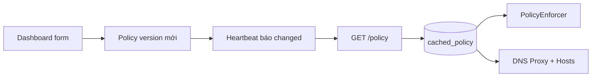

**Giới hạn hiện tại:** policy chưa có HMAC/chữ ký để Agent kiểm tra toàn vẹn. Route API trực tiếp `/policy` chưa khai báo xác thực phụ huynh; form Dashboard có kiểm tra đăng nhập nhưng chưa kiểm tra rõ `child.parent_id == parent.id` trước khi lưu.

**Kiểm thử liên quan:** `tests/test_policy.py`, `tests/test_weekly_schedule.py`, `tests/test_app_enforcer.py`.

## 8. Quota, lịch tuần, idle và khóa máy

Điểm xử lý chính là `PolicyEnforcer.tick()` và `run_loop(poll_interval=2.0)`.

### 8.1. Đếm thời gian sử dụng thật

Enforcer dùng `time.monotonic()` để tính thời gian giữa hai tick. Phần lẻ không bị bỏ đi mà được cộng vào `_subsecond_buffer`; chỉ phần nguyên giây mới ghi xuống SQLite. Nhờ đó sai số làm tròn không tích lũy sau hàng nghìn vòng lặp.

Thời gian chỉ được cộng khi:

- màn hình không bị khóa;
- người dùng không idle từ 300 giây trở lên;
- không bị phụ huynh khóa thủ công;
- các điều kiện quota/lịch còn cho phép.

`get_idle_seconds()` sử dụng `GetLastInputInfo`; `is_workstation_locked()` thử `OpenInputDesktop`, sau đó fallback sang `GetForegroundWindow`.

### 8.2. Lịch tuần

`check_schedule()` ưu tiên ma trận `7 × 48`:

```text
day  = now.weekday()                 # 0..6
slot = now.hour * 2 + minute // 30   # 0..47
allowed = matrix[day][slot]
```

Nếu không có ma trận hợp lệ, hàm fallback sang `start_time`–`end_time`, kể cả khung giờ qua đêm.

### 8.3. Xác định giới hạn hiệu lực

`get_quota_remaining_seconds()` tính quota còn lại. `get_schedule_remaining_seconds()` quét các slot được phép liên tiếp để tính thời gian đến vùng cấm. `get_effective_remaining_seconds()` chọn giới hạn kết thúc sớm hơn giữa quota và lịch.

### 8.4. Khóa và mở khóa

- `lock_workstation()` đặt `is_locked=1`, phát một event `locked`, rồi gọi `LockWorkStation()` trên Windows.
- `unlock_workstation()` xóa manual lock, grace period, warning state và đặt `is_locked=0`.
- `grant_extra_minutes(n)` không thay policy; hàm giảm `quota_used_seconds` đi `n × 60`, mở khóa và phát `override_granted`.
- `reset_usage_cache()` xóa event queue, đưa quota về 0 và mở khóa.

**Giới hạn hiện tại:** policy chỉ có `daily_minutes`, chưa có quota riêng ngày thường/cuối tuần và chưa có ngân sách theo nhóm ứng dụng.

**Kiểm thử liên quan:** `tests/test_screen_time_sync.py`, `tests/test_weekly_schedule.py`.

## 9. Cảnh báo 10/5/1 phút và ân hạn 60 giây

`PolicyEnforcer.check_and_emit_warnings()` sử dụng thời gian hiệu lực còn lại của quota/lịch.

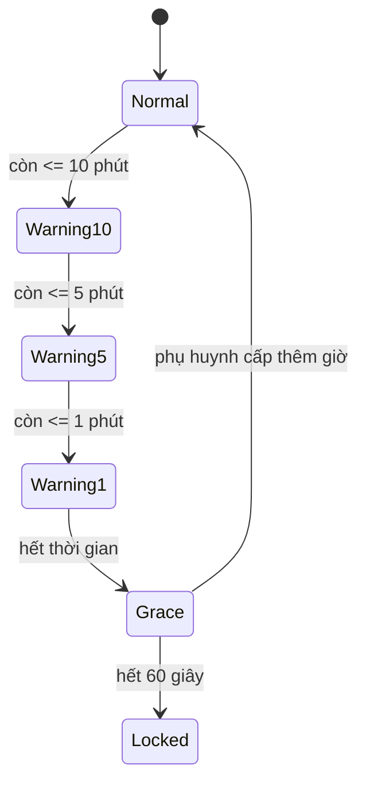

Mỗi cảnh báo:

- tạo đối tượng notification;
- thêm vào lịch sử tối đa 50 mục;
- ghi event `quota_warning`, trong đó `duration_sec` là số giây còn lại;
- gọi notifier mặc định để log và hiện Windows popup.

Tray UI lấy `active_notification`, `in_grace_period`, `grace_seconds_left` qua `GET /status`; đồng thời đọc `/notifications` để hiển thị toast/banner. Khi nhận `grant_minutes`, Enforcer hủy grace period và xóa các mốc cảnh báo đã phát.

**Kiểm thử liên quan:** `tests/test_warnings_and_grace_period.py`.

## 10. Chặn ứng dụng theo tên và SHA-256

Điểm xử lý: `PolicyEnforcer.scan_and_enforce_processes()` và `check_process_rule()`.

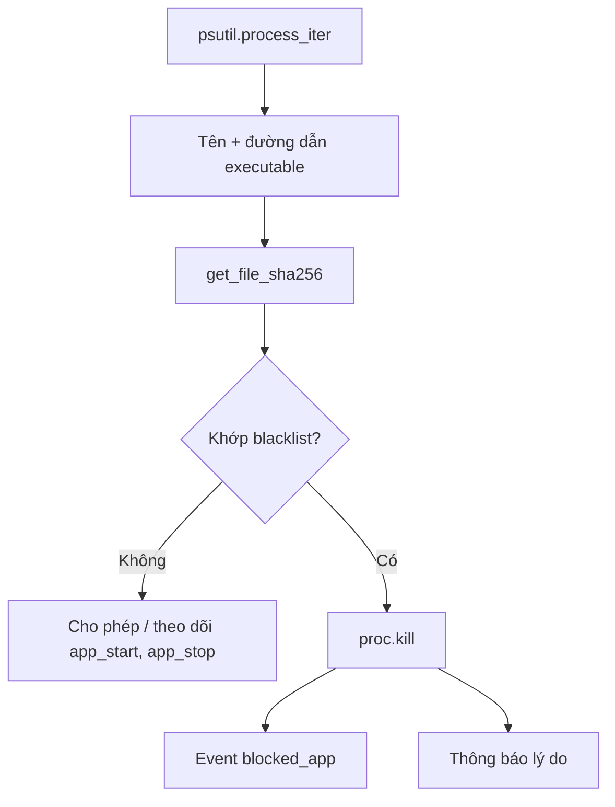

Rule hỗ trợ:

- `game.exe`;
- `game.exe:<64 ký tự SHA-256>`;
- chỉ SHA-256;
- dictionary có `name` và `sha256`;
- chuỗi hash từ output CertUtil có khoảng trắng.

`get_file_sha256()` cache theo thông tin file để không đọc lại executable trong mỗi chu kỳ hai giây. Enforcer duy trì danh sách hash hệ thống đã biết và danh sách tiến trình thiết yếu để tránh kill nhầm Windows. Khi chặn, Agent kill process, ghi `blocked_app` với tên app chuẩn hóa và gọi `notify_app_blocked()`. Thông báo cùng ứng dụng được chống spam trong tám giây.

Agent cũng theo dõi vòng đời process để tạo `app_start` và `app_stop`; `app_stop.duration_sec` được dùng cho báo cáo thời lượng ứng dụng.

**Giới hạn hiện tại:** chỉ có blacklist, không có allowlist thực sự; hiệu lực trên process hệ thống hoặc process quyền cao còn phụ thuộc quyền của Agent.

**Kiểm thử liên quan:** `tests/test_app_enforcer.py`.

## 11. Lọc website bằng DNS Proxy và file hosts

Chức năng web có hai lớp cùng sử dụng policy cache.

### 11.1. Lớp file hosts

`HostsBlocker.apply_blacklist()`:

1. Đọc file hosts hiện tại.
2. Xóa khối ChildGuard/SafeSearch cũ.
3. Chuẩn hóa và loại bỏ miền thuộc permanent bypass list.
4. Sinh bản ghi `0.0.0.0` và `::` cho miền gốc, `www.` và một số biến thể `m.`.
5. Thêm bản ghi SafeSearch nếu được bật.
6. Ghi lại file; nếu thiếu quyền thì dùng PowerShell `RunAs` để yêu cầu UAC.
7. Chạy `ipconfig /flushdns`.

### 11.2. Lớp DNS Proxy

`DNSProxyServer.start()` bind UDP `127.0.0.1:53`; mỗi query được xử lý trong một thread.

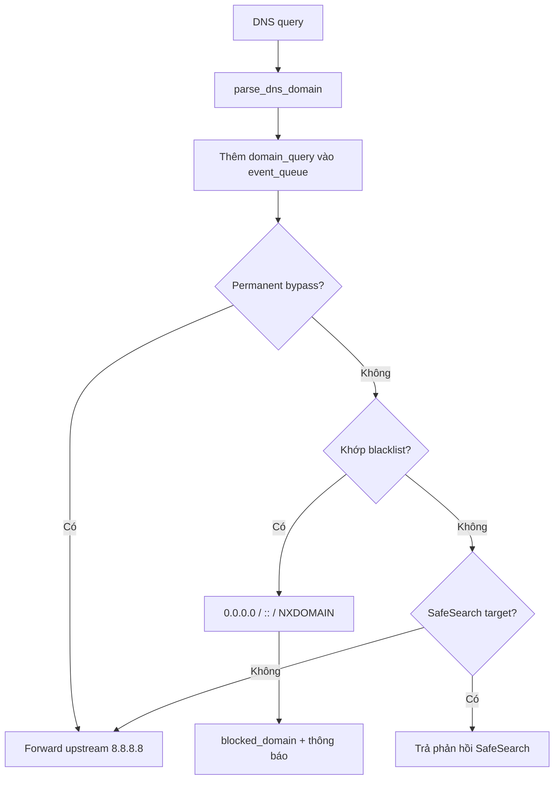

`build_blocked_response()` trả kết quả phù hợp với loại truy vấn: A → `0.0.0.0`, AAAA → `::`, loại khác → NXDOMAIN. `normalize_domain_subject()` chuyển QNAME thành eTLD+1 trước khi lưu event. Vì vậy hệ thống không lưu URL, path hoặc query string.

Khi mất kết nối trên ba ngày, `sync_policy_rules()` bổ sung `facebook.com`, `tiktok.com`, `youtube.com` vào blacklist degraded. Hệ thống không tự fail-open sau 14 ngày.

**Giới hạn hiện tại:** file hosts chỉ bao phủ các hostname được ghi rõ; DNS proxy có thể bị bỏ qua bởi DoH/VPN nếu không có policy hệ điều hành/trình duyệt bổ sung. Việc cấp quyền Modify file hosts cho toàn bộ nhóm Users làm tăng rủi ro sửa file và nên được siết lại trong bản triển khai thật.

**Kiểm thử liên quan:** `tests/test_hosts_blocker.py`.

## 12. Hàng đợi sự kiện ngoại tuyến và chống trùng

`AgentStorage.add_event()` chỉ chấp nhận chín loại event trong event contract. Hàm chuẩn hóa subject, kiểm tra các loại bắt buộc subject, sinh `ev_<uuid>` và dùng thời gian UTC đã neo với server.

Các event được lưu vào `event_queue` với `sent=0`. Một thread độc lập trong SyncWorker chạy mỗi năm giây:

1. `get_pending_events(limit=100)` lấy tối đa 100 event.
2. `_flush_events_batch_locked()` chuyển thành payload Event Item.
3. Gọi `POST /events/batch` bằng access token.
4. Server lấy Device từ token, gắn `device_id` và `child_id` đáng tin cậy thay vì nhận hai giá trị này từ payload.
5. Server kiểm tra `idempotency_key`; key đã tồn tại được tính vào `ignored`.
6. Event mới được ghi vào `EventLog`.
7. Sau response thành công, Agent gọi `mark_events_sent()` rồi xóa các event tương ứng.

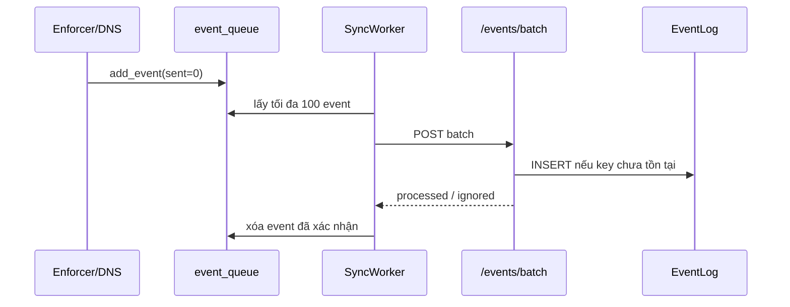

Vì event flush chạy riêng, lỗi heartbeat hoặc tải policy không làm queue dừng đồng bộ. Nếu gửi thất bại, event vẫn ở local database để thử lại.

**Kiểm thử liên quan:** `tests/test_events_batch.py` và các test report/retention.

## 13. Lệnh khẩn qua WebSocket và heartbeat dự phòng

Các command hợp lệ trong code: `lock`, `unlock`, `grant_minutes`, `clear_data`, `clear_child_data`.

### 13.1. Server tạo lệnh

`create_command()`:

1. Kiểm tra Device tồn tại và loại command hợp lệ.
2. Tạo bản ghi `Command` có `created_at` và payload JSON.
3. `ConnectionManager.send_command()` gửi tới mọi WebSocket đang gắn với device.
4. Nếu gửi frame thành công, đặt `delivered_at`.

### 13.2. Agent nhận và thực thi

`SyncWorker._websocket_loop()` kết nối `wss://server/ws/{device_id}?token=...`, bật ping interval 20 giây và tự reconnect sau năm giây. Server kiểm tra token, trạng thái Device và device_id; khi kết nối thành công, Server gửi `time_sync` và các command chưa giao.

`execute_command()` ánh xạ:

| Command | Hàm Agent |
|---|---|
| `lock` | `enforcer.lock_workstation(manual=True)` |
| `unlock` | `enforcer.unlock_workstation()` |
| `grant_minutes` | `enforcer.grant_extra_minutes(minutes)` |
| `clear_data` | `enforcer.reset_usage_cache()` |

Sau khi thực thi, Agent gọi `POST /commands/{id}/ack`; đồng thời gửi frame ACK qua WebSocket. Server ghi `acked_at`.

Heartbeat cũng trả các command có `delivered_at IS NULL`. Đây là đường dự phòng khi Agent không có WebSocket.

**Giới hạn hiện tại:** command được loại khỏi heartbeat ngay khi `delivered_at` được đặt, không phải khi có `acked_at`. Nếu WebSocket gửi frame thành công nhưng Agent mất kết nối trước khi xử lý, command có thể không được giao lại tự động.

**Kiểm thử liên quan:** `tests/test_commands.py`, `tests/test_heartbeat.py`.

## 14. Trẻ gửi yêu cầu xin thêm giờ

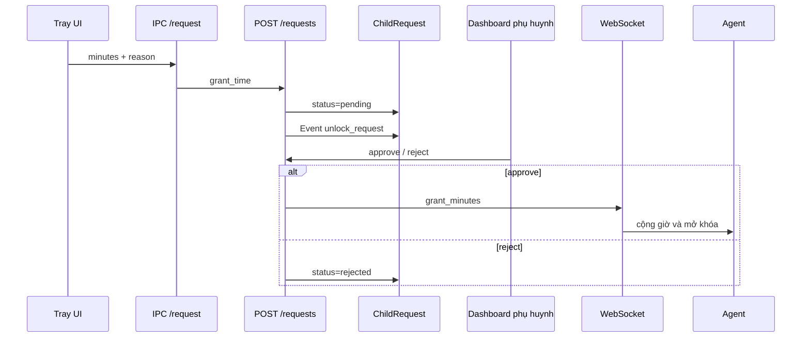

`TrayApp.send_request()` gọi IPC cục bộ. `IPCHandler.do_POST()` chuyển yêu cầu qua access token của Agent. `create_child_request()` lấy child/device từ token, tạo `ChildRequest` và một `EventLog` loại `unlock_request`.

Khi phụ huynh duyệt, `process_child_request()` lấy số phút từ `subject`, tạo command `grant_minutes` và gửi ngay nếu WebSocket online. Khi từ chối, request chuyển sang `rejected`. Cả hai trường hợp đều ghi `resolved_at`.

**Giới hạn hiện tại:** các route API liệt kê/xử lý request trực tiếp chưa có dependency phụ huynh và ownership. Trang Dashboard có kiểm tra đăng nhập nhưng truy vấn danh sách request hiện không lọc theo parent.

**Kiểm thử liên quan:** `tests/test_requests.py`, test IPC trong `tests/test_warnings_and_grace_period.py`.

## 15. Tray UI, IPC và giao diện minh bạch

`TrayApp` không đọc trực tiếp database. Nó gọi hai endpoint loopback:

- `GET /status`: quota, số phút đã dùng/còn lại, lock/idle, grace period, notification, app bị hạn chế, policy, queue và trạng thái sync.
- `GET /notifications`: lịch sử tối đa 50 notification.
- `POST /request`: yêu cầu thêm 15/30/60 phút và lý do.

Các cửa sổ chính trong `agent/tray/tray_app.py`:

- `show_child_today_window()`: “Góc của bé/Hôm nay em đã dùng gì”.
- `show_transparency_window()`: hiển thị quota, lịch, app/web bị hạn chế và trạng thái bảo vệ.
- `show_request_window()`: nhập lý do và chọn số phút.
- `show_toast_banner()`: hiển thị thông báo/cảnh báo nổi.

Trong `run()`, một daemon cập nhật tooltip/menu định kỳ để thời gian còn lại không bị đứng. Các cửa sổ dùng dữ liệu mới từ IPC thay vì giữ snapshot lúc mở.

**Giới hạn hiện tại:** IPC chỉ bind loopback nhưng chưa có local token, trả `Access-Control-Allow-Origin: *` và không xác thực tiến trình gọi. Một chương trình khác trong cùng máy có thể đọc status hoặc gửi request thay cho Tray.

## 16. Báo cáo và phân loại website

`get_child_stats_summary()` tổng hợp EventLog theo múi giờ `Asia/Ho_Chi_Minh`:

- thời lượng hôm nay và bảy ngày gần nhất từ `app_stop.duration_sec`;
- biểu đồ 24 giờ;
- phân bổ sáng/chiều/tối/đêm;
- top `blocked_app` và `blocked_domain`;
- 20 event gần nhất;
- sáu nhóm website;
- quota và phần trăm đã dùng.

`domain_categories.py` nạp `server/data/website_categories.csv` gồm 200 website. Với `domain_query` chưa có duration thực, báo cáo ước tính mỗi cặp `(domain, phút)` có query là một phút và khử trùng các query lặp trong cùng phút. Nếu event tương lai có `duration_sec > 0`, giá trị thật được ưu tiên.

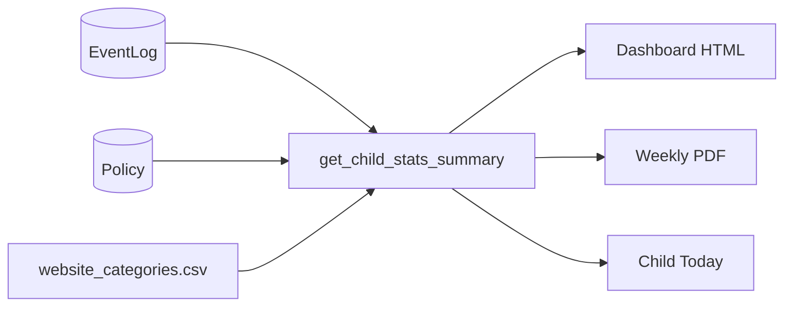

Dashboard `/dashboard/reports` chỉ lấy Child thuộc Parent đang đăng nhập; partial recent-events cũng kiểm tra cặp child/parent và refresh qua HTMX với `Cache-Control: no-store`. `/dashboard/reports/export-pdf` xuất báo cáo tuần.

**Giới hạn hiện tại:** các API trực tiếp `/reports/{child_id}` và `/reports/{child_id}/pdf` chưa yêu cầu parent session/ownership. Thời lượng website là ước tính từ DNS query, không phải thời gian tab thực sự ở foreground.

**Kiểm thử liên quan:** `tests/test_reports_and_retention.py`.

## 17. Retention 90 ngày và xóa dữ liệu hai phía

### 17.1. Dọn dữ liệu tự động

Trong `server/app/main.py`, lifespan:

1. chạy `cleanup_old_logs(days=90)` khi server khởi động;
2. tạo `_periodic_retention_cleanup()` chạy mỗi 86.400 giây.

`cleanup_old_logs()` xóa EventLog, AuditLog, Command và ChildRequest có timestamp cũ hơn cutoff.

### 17.2. Nút xóa toàn bộ dữ liệu của trẻ

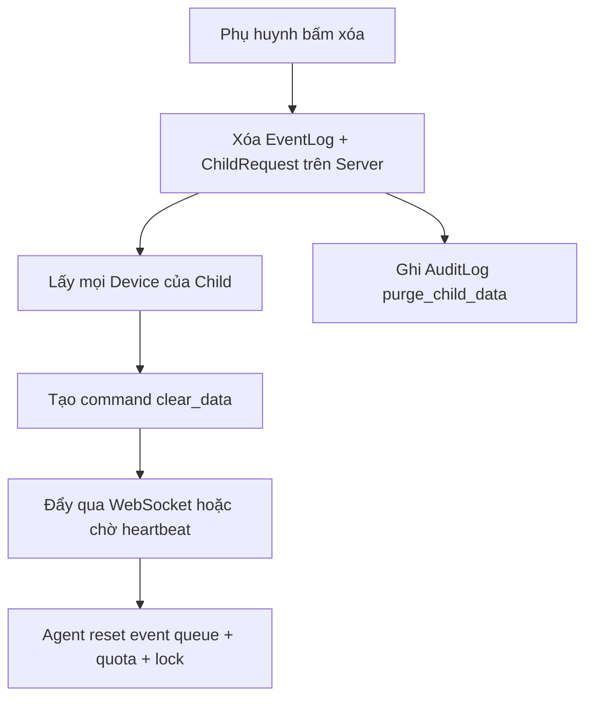

`purge_child_data_action()` là luồng Dashboard; `purge_child_data_api()` là API trực tiếp. Agent nhận `clear_data` trong `SyncWorker.execute_command()` và gọi `enforcer.reset_usage_cache()`.

**Giới hạn hiện tại:** xóa local cache phụ thuộc command được Agent nhận; nếu thiết bị không bao giờ online lại, bản cache còn trên máy. Dashboard purge kiểm tra đăng nhập nhưng hiện chỉ `db.get(child_id)`, chưa ràng buộc `child.parent_id == parent.id`. API trực tiếp chưa có auth phụ huynh.

**Kiểm thử liên quan:** `tests/test_reports_and_retention.py`.

## 18. Audit log và trạng thái thiết bị

AuditLog hiện có các trường `actor_type`, `actor_id`, `action`, `detail_json`, `created_at`. Các hành động đang được ghi tại nhiều luồng:

- `parent_registered`;
- `parent_login`;
- `enrollment_completed`;
- `policy_updated`;
- `purge_child_data`;
- `manual_retention_cleanup`;
- các thao tác Dashboard khác có audit trong router.

Dashboard tính trạng thái thiết bị từ `Device.last_seen_at`. Heartbeat, WebSocket và event batch đều có thể cập nhật thời điểm này. Overview hiển thị online/offline, quota, policy version và các nút điều khiển.

**Giới hạn hiện tại:** model AuditLog chưa có cột IP, old value và new value riêng; `detail_json` không thay thế đầy đủ yêu cầu audit “ai, lúc nào, IP nào, trước/sau”. Một số trang audit/request vẫn cần rà soát ownership.

## 19. Dữ liệu chính đi qua hệ thống

### 19.1. Policy

```json
{
  "version": 15,
  "quota": {"daily_minutes": 90},
  "schedule": {"start_time": "07:00", "end_time": "21:30", "matrix": []},
  "app_rules": {"mode": "blacklist", "blacklist": ["game.exe:<sha256>"]},
  "domain_rules": {"mode": "blacklist", "blacklist": ["example.com"], "safesearch": true}
}
```

### 19.2. Event Item

```json
{
  "idempotency_key": "ev_6c47...",
  "type": "blocked_domain",
  "subject": "youtube.com",
  "duration_sec": 0,
  "policy_version": 15,
  "created_at": "2026-10-18T08:30:00Z"
}
```

Chín type hợp lệ:

```text
app_start, app_stop, domain_query, blocked_app, blocked_domain,
quota_warning, locked, unlock_request, override_granted
```

### 19.3. Command

```json
{
  "command_id": "...",
  "type": "grant_minutes",
  "payload": {"minutes": 15}
}
```

## 20. Các điểm đã hiện thực nhưng cần hoàn thiện trước triển khai thật

Các mục dưới đây không phủ nhận chức năng đã có, nhưng cần được ghi rõ để không đánh đồng nguyên mẫu phòng lab với sản phẩm production:

1. Thay băm mật khẩu SHA-256 bằng Argon2id hoặc scrypt.
2. Chuyển session secret ra biến môi trường; thêm Secure cookie, CSRF và session revocation.
3. Bắt buộc parent authentication và ownership cho mọi API policy, command, request, report và purge.
4. Thêm HMAC/chữ ký policy để Agent từ chối policy bị sửa.
5. Không dùng SSL unverified fallback khi thiếu CA.
6. Thêm token/ACL cho IPC loopback.
7. Không cấp Modify file hosts cho toàn bộ nhóm Users trong bản production.
8. Chỉ đánh dấu command hoàn tất khi có ACK và có chiến lược retry command chưa ACK.
9. Hoàn thiện quota ngày thường/cuối tuần, allowlist và ngân sách theo nhóm ứng dụng nếu bám đầy đủ đề bài.
10. Thu thập phép đo thật trên Windows cho độ trễ policy/command, DNS p50/p95, CPU và RAM.

## 21. Bản đồ từ chức năng tới test

| Chức năng | Test chính |
|---|---|
| Enrollment và token | `test_enroll.py` |
| Auth/Dashboard và luồng tích hợp | `test_auth_dashboard.py` |
| Heartbeat và policy version | `test_heartbeat.py`, `test_policy.py` |
| Command và ACK | `test_commands.py` |
| Event batch/idempotency | `test_events_batch.py` |
| Request của trẻ | `test_requests.py` |
| Quota, idle, time sync | `test_screen_time_sync.py` |
| Lịch 7×48 | `test_weekly_schedule.py` |
| Cảnh báo và grace period | `test_warnings_and_grace_period.py` |
| Chặn app/SHA-256 | `test_app_enforcer.py` |
| DNS/hosts/SafeSearch | `test_hosts_blocker.py` |
| Reports, retention, purge, PDF | `test_reports_and_retention.py` |

## 22. Kết luận luồng end-to-end

Luồng đầy đủ của hệ thống hiện tại có thể tóm tắt như sau:

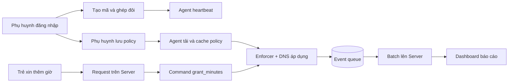

Đây là luồng đã được nối từ giao diện phụ huynh tới máy trẻ và ngược lại. Những phần còn thiếu chủ yếu nằm ở hardening bảo mật, kiểm tra ownership toàn diện, chữ ký policy, khả năng chống bypass nâng cao và bằng chứng đo trên môi trường Windows thật.
